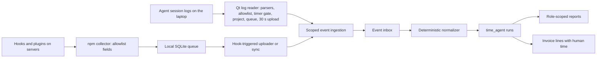

# Agent time tracking implementation plan

Status: confirmed implementation specification, revised after a design review on 12 October 2026. Vendor research checked 12 October 2026. Repository baseline: `dev` at `1fceeaad`. This revision replaces the earlier proposal (written against `7d559faf` on `feat/0-google-login`), which kept agent time non-billable and out of invoices. The collection model was revised on 13 October 2026: on laptops the Qt desktop tracker receives agent events and counts them only while its timer runs (timer mode); servers track into a configured project (fixed mode). Laptop collection was revised again on 15 October 2026: the Qt app reads each agent's local session logs instead of receiving hook events. Agent identity, assignment and the assisted/autonomous split were revised on 15 October 2026, and a documentation review on 17 October 2026 removed drift between this plan, SPEC and the other plans.

Work Address tracks the time AI agents spend working on a project, separately from human time, and bills it. A worker keeps a list of agents, one or more per product, attaches them to projects they work on and sets a rate for each. The worker's invoice carries a line for their own hours and a line for each agent. Use deterministic lifecycle signals from the agents' own records (their local session logs on laptops, their hooks and plugins on servers); expose incomplete coverage where they are not available. Do not make the language model responsible for starting or stopping a timer.

In this plan, **worker** means whoever runs the agents: a project worker, or the project owner tracking their own agents.

This plan covers Claude Code, Codex, Cursor, Gemini CLI, GitHub Copilot (CLI and VS Code), Windsurf, Cline, MiniMax Agent, Devin Local, Claude Cowork, current Kimi Code, legacy Kimi CLI, OpenClaw, NousResearch Hermes Agent, OpenCode and an extension path for other runtimes. "Hermes" means NousResearch Hermes Agent; consumer Kimi Agent/Work support is a separate capability from its coding tools. Vendor capabilities below are supported by opened primary documentation, but no adapter has been installed or run. All new APIs, fields, package names, limits and phases are proposed Work Address contracts, not existing functionality.

### Relation to earlier documents

- **`web/docs/research/metering-the-agent-hour.html` (r7, 28 Aug 2026).** Adopted: agent work is billable; an itemised invoice with human and agent lines; a rate per agent rather than one project rate; evidence frozen when an invoice is issued. Not adopted: an agent as its own `User` with a keypair and `operatorAddress` (agents are entries under the worker here), an `agentActivity` bag on `Time` (agent runs get their own table), and re-keying `time` to `(project, user, fromAt)` (not needed, since agent rows never enter `time`). Deferred: at-cost pass-through lines and third-party corroboration.
- **`web/docs/development-plan.md:163`** leaves "AI-agent metering" out of the first marketplace launch. This plan targets `dev` and does not depend on `feat/0-marketplace`.

## Product contract

- Preserve the current desktop tracker and its human activity records. Human `Time` rows, queries and behaviour are unchanged.
- On a worker's laptop, agent work counts only while the desktop tracker's timer is on for the project the run started under. Agent work that starts while the timer is off is not recorded.
- On a laptop, the desktop tracker reads the agents' own local logs; nothing has to be installed in the agent tools.
- On a server, an agent is tracked whenever it works, into the project its collector was configured with.
- The project owner decides whether a project records agent time at all: `trackAgents`, off by default, beside the screenshot and app switches. Off means nothing is collected for that project on any machine; the worker's attachments and rates wait until it is on.
- A worker owns a list of agents, one or more per product (for example "Claude Code (laptop)" and "Claude Code (build server)"), each optionally bound to the machines it runs on. They attach agents to projects they work on and set each agent's hourly rate for that project, starting at $0.00.
- Agent time is **assisted** while the same worker's own timer runs on the same project, and **autonomous** otherwise, wherever the agent runs. Both are billed; each agent line shows how much of it was assisted, so the client sees when they pay for a person and an agent in the same hour.
- Agent time is billable. One invoice per worker per period carries a human line and one line per agent, each at its own rate.
- Never add human hours and agent hours into one figure. Money may be added: dashboards show human, agent and combined amounts.
- Only the worker adds, edits, removes or detaches their agents. The project owner sees every agent, rate and run on the project but cannot change them. The owner's protections are rejecting an invoice and removing the worker.
- Other workers see nothing of another worker's agents: not the agent, its time, its rate or its content. Viewers see nothing about agents.
- Capture tokens, model, timings, outcome, tool names with counts and durations, commit SHAs, a count of changed files, and the prompt that started the run (up to 4,000 characters; the worker can turn this off). Do not capture response text, file paths, tool arguments or results, file contents, command output or model reasoning. Agents never trigger screenshots or input-activity capture.
- Agent records are produced by the worker's own collector. Detailed statistics are the evidence; no tamper-proof labour claim is made. The owner's remedy for a wrong invoice is rejection.
- A manual timer is a fallback where automatic tracking does not qualify. Manual time is billable and flagged `manual` on the invoice line.

## Decisions

| Area | Decision | Not chosen |
| --- | --- | --- |
| Purpose | Agent time is billable work | Observability only; parking the feature |
| Agent identity | An entry in the worker's agent list; one or more per product, each optionally bound to machines, one default per product. Revised 15 Oct 2026 | Agent as its own `User` (memo); strictly one per product; tagging runs by hand |
| Agent assignment | `WORK_ADDRESS_AGENT` in the agent process, then the machine's binding, then the product's default agent; otherwise the run waits. Fixed when the run starts | Assignment by product only |
| Assisted and autonomous | Assisted = agent time while the same worker's own timer runs on the same project; autonomous = the rest, wherever the agent runs. Computed on read; frozen on invoice lines as `assistedMinutes` | Splitting by laptop versus server; splitting by who started the run |
| Overlap with human time | Both human and agent time are billed; each agent line states its assisted part | Not billing assisted time by default |
| Storage across modes | One `time_agent` table for laptop and server runs; mode and surface recorded per run | Separate tables per mode or tool family |
| Owner switch | `Project.trackAgents`, owner-only, off by default. Off means no collection anywhere for the project; both the switch and the worker's attachment are needed. Turning it off ends counting for open runs at that moment. Decided 18 Oct 2026 | On by default; collected but unbilled; laptop-only gating |
| Storage | `time_agent` table in the Time domain, one row per run | A `kind` column on `time`, which forces a human filter into ~28 server and 6 web call sites |
| Attachment | A worker-managed agents list on Project, beside `workerAddresses` | Agents inside the owner-managed `workerAddresses` |
| Rate | Set by the worker per project from $0.00; the rate when the invoice is created prices every hour on the line, as for human hours. Every change is logged for the owner, and an invoice line flags hours a change repriced. Reviewed 13 Oct 2026 | Owner-set rates; acknowledgement gates; pricing hours by a rate history; locking the rate while hours are unbilled |
| Invoice | One per worker per period: human line plus one line per agent, frozen snapshot | One invoice per agent; a separate agent-only invoice |
| Rejection | New `REJECTED` state on every invoice, whole invoice only, releases its rows; ships first as its own change | Line-level rejection; agent-only rejection |
| Billed time | Per agent and project: the union of all that agent's tracked run time, so overlapping runs of one agent count once; different agents and different projects each bill their own. Waits for a person, unclassified spans and manual time are billed and flagged. Revised 13 Oct 2026 | Summing overlapping runs of one agent; excluding waits; one union across all agents |
| Invoicing runs | Only finished runs; invoiced rows freeze; late corrections are quarantined | Updating invoiced rows; waiting out the correction window |
| Nested agents | The outer run is the task; inner runs are its children, billed once at the outer agent's rate | Inner product's rate; per-pairing choice |
| Removal | Worker detaches an agent: past hours stay invoiceable at its last rate. Owner removes the worker: agent hours follow the worker's existing rule and cannot be invoiced | Agents keeping billing rights their worker lost |
| Visibility | Owner: everything. Worker: own agents only. Viewer: nothing | SPEC's project-wide time visibility for agents |
| Content | Tokens, model, timings, outcome, tool names/counts/durations, commit SHAs, changed-file count, and the prompt that started the run, up to 4,000 characters, shown to the worker and the owner; on by default, the worker can keep it local. No response text. Revised 24 Oct 2026; previously no prompt text | Response text; paths, tool arguments/results, reasoning; prompts the owner cannot see |
| Field allowlist | The log reader (laptops) and the collector (servers) keep only allowlisted fields and drop everything else (prompt and response text, code, tool arguments and output, email addresses, paths) before an event leaves the machine; the server rejects unknown fields | Storing text and redacting it |
| Products | Laptops, read from local logs, in waves: Claude Code, Codex, Cursor IDE, Gemini CLI, Kimi Code, MiniMax; then Copilot CLI and Copilot in VS Code; then Windsurf and Cline, time only, with OpenCode and Devin Local where their stores qualify. Servers: OpenClaw, Hermes and any tool run headless. Each behind its own flag as it qualifies; Cowork through plugin hooks only | One release for all; organisation-level Cowork OTel; Aider, Roo Code, Cursor CLI in `-p` mode |
| Collection modes | Laptops with the Qt app: the **Qt log reader** (timer mode). Servers, and machines without the Qt app: the npm collector (**fixed mode**). Revised 15 Oct 2026 | One collector for every environment |
| Laptop collection | The Qt app reads each tool's local session logs, keeps only allowlisted fields in memory, rebuilds runs, applies the timer gate and uploads. No hooks, no Node and no local socket on laptops. Revised 15 Oct 2026; previously hook → collector → Qt app over a local socket | Hooks and the npm collector on laptops; a Qt socket receiver; a Qt-shipped hook helper |
| Laptop project | The Qt app's project when the run starts. Revised 13 Oct 2026; replaces folder mappings | Folder mappings; mismatch warnings |
| Timer gate | A run counts only while the timer is on for the project it started under. Stopping or switching to another project pauses it; restarting or switching back resumes it. Idle auto-stop and suspend count as stopping. Revised 13 Oct 2026; agents were previously tracked whatever the timer did | Any running timer; never resuming |
| Timer off | Runs that start while the timer is off are not recorded; the Qt app offers **Start timer** | Holding them for later assignment |
| Server project | Set at setup, overridable per agent process with `WORK_ADDRESS_PROJECT` | Folder or channel mapping |
| Tokens | From the same local logs as run timing (laptops) or the transcript at Stop (servers), by parsers pinned to qualified versions; null otherwise | OTel receiver; hook payloads only |
| Measurement | Full model computed on the server from an event inbox | Run assembly in the collector |
| Collector | Laptops: the Qt log reader, no Node needed. Servers: npm package and agent-native plugins; pip shim for Hermes | Standalone binaries; Homebrew; hooks on laptops |
| Upload | Timer mode: the Qt app uploads every 30 seconds. Fixed mode: no resident service; a hook-triggered uploader with a queue lease, a synchronous flush at Stop in cloud/CI, and a `sync` command | OS login services |
| Credentials | Per machine, write-only, scoped to the worker's agents and projects, 90 days. The Qt app requests one with its sign-in and uses it for its own uploads | The worker's JWT; the memo's agent keypair |
| Baseline | `dev`, using the repository's `schema:sync` | `feat/0-marketplace`; new migration tooling |

## Integration findings

Every tool's hooks and local records are compared in [agent-data-sources.md](agent-data-sources.md). "Documented" means a primary source describes the surface. "Qualified" must mean our conformance tests pass on a recorded product version and deployment. None of these adapters is qualified yet.

| Product and surface | Documented capture route | Implementation choice | Qualification boundary |
| --- | --- | --- | --- |
| Codex local CLI and desktop runtime | Lifecycle hooks; app-server notifications; noninteractive JSONL; OTel | Laptops: Qt log reader on `~/.codex/sessions`. Servers: native hooks, or `codex exec --json` for runs our integrator launches | Pin version; prove continuations, interruption and wait coverage from the rollout records; hook trust on servers |
| Claude Code | Session logs; hooks; optional OTel traces/metrics | Laptops: Qt log reader on `~/.claude/projects`. Servers: native hook adapter, tokens from the transcript at Stop | Interruption and continuation must be recognisable in the records; Stop hooks alone miss interruption |
| Claude Cowork | Plugin hooks; Team/Enterprise OTel; cloud and legacy local execution | Plugin hooks only, shipped in the Claude Code plugin | Lifecycle coverage and authenticated cloud egress must pass; otherwise the manual timer |
| Cursor IDE | Local SQLite store (confirmed on 3.24.12: timing, outcome, model, subagents, changed lines; `tokenCount` present but empty); hooks: `beforeSubmitPrompt`, `stop` (`completed`/`aborted`/`error`), session and tool events | Qt log reader on the store, read-only; tokens null | Store undocumented and holds prompts and code beside the fields read, so the allowlist is enforced row by row; the Cursor CLI's records are unverified |
| Gemini CLI | Hooks: `BeforeAgent`, `AfterAgent`, `AfterModel` with usage; transcript; OTel | Qt log reader on `~/.gemini/tmp` session files, including tokens | An aborted turn has no end record: close it at the next turn, session end or staleness. Whether Antigravity CLI keeps these files is unverified |
| GitHub Copilot CLI and VS Code | Hooks: `userPromptSubmitted`/`agentStop` (CLI), `UserPromptSubmit`/`Stop` (VS Code); OTel for model and tokens | Qt log reader where a local session record qualifies (the CLI under `~/.copilot`, VS Code chat sessions in its storage); tokens null | Local record formats unverified; tokens appear only in OTel, deferred |
| Windsurf | Hooks: `pre_user_prompt`, asynchronous `post_cascade_response` | Qt log reader if a local record qualifies, otherwise unsupported on laptops; time only | No documented local session log; its transcript file is written only by a hook |
| Cline | Hooks per task: `TaskStart`, `TaskComplete`, `TaskCancel` | Qt log reader on its task files in VS Code's storage, one run per task | Task-file format unverified; tokens appear in task files |
| Current Kimi Code | Local session store (`~/.kimi-code/sessions`, fields confirmed); hooks and experimental Server API | Laptops: Qt log reader on the session store, one stream per subagent, with explicit wait pairs. Servers: hooks first; Server API for qualified richer observation | Current codebase, installed schemas and cross-process visibility |
| MiniMax Agent | Local SQLite runtime store (confirmed: turn timing, tokens, cost, outcome, scheduled runs); hooks undocumented | Laptops: Qt log reader on `~/.minimax/v2/sqlite/runtime-state.sqlite`, read-only; message bodies never read | Store undocumented; whether the `mcode` CLI writes the same store is unverified |
| Legacy Kimi CLI | Wire JSON-RPC transport | Optional separate adapter for explicitly launched legacy sessions | Archived codebase; separate compatibility package |
| OpenClaw | Typed plugin observers, diagnostic events, OTLP | Passive plugin/diagnostic adapter | Session attribution, nested-harness correlation, incomplete wait visibility |
| Hermes Agent | Python observer hooks | Passive observer plugin via a pip shim that hands events to the npm collector | Per-turn end semantics, delayed child callbacks, version-pinned observer contract |
| OpenCode | Local store; JS/TS plugin lifecycle events | Laptops: Qt log reader on its local store. Servers: native plugin | Verify start/status, permissions and terminal payloads |
| Devin Local | Local desktop and CLI history (named in Firstlight's release notes; unverified) | Qt log reader if the store qualifies | Location and format unverified |
| Other agents and frameworks | Explicit SDK callbacks or qualified OTel spans | Public emitter SDK and adapter interface | No claim that arbitrary MCP/OTel support provides full run lifecycle |

### Local session logs (laptops)

The Qt log reader uses the files each tool already writes. The full findings, including Kimi Code, MiniMax and server runtimes, are in [agent-data-sources.md](agent-data-sources.md). Field names for Claude Code, Codex, Kimi Code, MiniMax and Cursor were confirmed in real local data on macOS on 15–17 October 2026 (names only, no content); the rest is expected and must be confirmed in Phase 0.

| Tool | Location | What the reader uses |
| --- | --- | --- |
| Claude Code | `~/.claude/projects/<project>/<session>.jsonl` on macOS and Linux; `%USERPROFILE%\.claude\projects\` on Windows, or inside WSL | Per record: `timestamp`, `sessionId`, `promptId`, `parentUuid`, `isSidechain` (subagents), `permissionDecision`, `version`. Assistant records: `message.model`, `message.usage` (input, output, cache read and cache creation tokens), `stop_reason` |
| Codex | `~/.codex/sessions/YYYY/MM/DD/rollout-*.jsonl`; `%USERPROFILE%\.codex\` on Windows, usually inside WSL | `task_started` and `task_complete` (`turn_id`, `started_at`, `completed_at`, `duration_ms`); `token_count` (`total_token_usage`, `last_token_usage`); `session_meta` (`model`, `cli_version`); tool-call names |
| Gemini CLI | `~/.gemini/tmp/<project>/` session files on every OS | Turn boundaries and token counts; field names unverified |
| Cursor | SQLite `state.vscdb` under Cursor's `User/globalStorage`: `~/Library/Application Support/Cursor/` (macOS), `~/.config/Cursor/` (Linux), `%APPDATA%\Cursor\` (Windows) | `composerHeaders` (`createdAt`, `lastUpdatedAt`, `isSubagent`, `subagentTypeName`, lines added and removed, files changed); `composerData` records (`status` completed/aborted, `modelConfig.modelName`, `createdAt`, `lastUpdatedAt`); `bubbleId` records (`createdAt` per message, `modelInfo.modelName`, `errorDetails`). `tokenCount` is present but empty on 3.24.12, so tokens are null |
| Kimi Code | `~/.kimi-code/sessions/<workDirKey>/<sessionId>/` on every OS | `state.json` (`cwd`, `lastTurnReason`); `agents/<agent>/wire.jsonl`: `turn.prompt` / `turn.ended` (`turnId`, `durationMs`), `usage.record`, `model`, `interaction.request` / `interaction.resolved` wait pairs |
| MiniMax Agent | `~/.minimax/v2/sqlite/runtime-state.sqlite` (macOS; other OSes unverified) | `local_runtime_turn_ingress` (`turn_id`, `accepted_at_ms`, `completed_at_ms`, `status`), `local_runtime_token_usage` (tokens by kind, `model`, `cost_usd`), `local_runtime_session_agent_state` (`terminal_outcome`), cron tables for scheduled runs |
| OpenCode, Cline, Copilot, Devin Local, Windsurf | Their own stores: OpenCode under `~/.local/share/opencode`; Cline task files and Copilot chat sessions in VS Code's storage; the others unverified | Qualified per tool in its phase; unsupported until then |

**Per OS.**

- **macOS:** the agents' home folders, and Cursor's folder under Application Support, are expected to need no privacy prompt, because Cursor is not sandboxed. Phase 0 confirms it.
- **Windows:** native installs live in the user's profile. Installs inside WSL are read through `\\wsl.localhost\<distribution>\home\<user>\`, only while the distribution runs, and by polling, because file watching does not work over that bridge. If that proves unreliable, the npm collector runs inside WSL in fixed mode instead.
- **Linux:** plain files in the home folder, with no display-server dependency, so it works on Wayland too. Flatpak and Snap editions keep their data under `~/.var/app/` or `~/snap/`. inotify's per-user watch limit can be reached with many session files, which polling covers. The Qt app still has no Linux installer (`time-tracker/docs/install-ubuntu.html:359`), which limits Linux reach whatever the collection method.

**Formats.** None of these formats is documented as a contract: Codex calls its transcripts unstable, and Claude Code's logs carry record types that appear in no documentation. Each parser is therefore pinned to the versions it was qualified on and tested against recorded, sanitized fixtures; an unknown version is reported as unsupported, never guessed.

### Codex

The hook reference documents `UserPromptSubmit`, `Stop`, `Interrupt`, `SessionStart/End`, `SubagentStart/Stop`, tool hooks and `PermissionRequest`. Turn hooks expose `turn_id`; common input has `session_id`; subagent hooks use the parent session ID plus `agent_id`. `SessionEnd` is not a turn boundary. Stop hooks can cause continuation. Non-managed hooks need trust review, and plugin hooks are skipped until the user trusts them. Use a short, silent local enqueue handler; validate event-specific success output, including JSON for Stop. Transcript formats are explicitly unstable. On laptops the Qt log reader parses the session rollout files anyway, pinned to qualified CLI versions (see [Local session logs](#local-session-logs-laptops)); on servers, hooks read only the token usage at Stop. Unknown versions store null. [Codex hooks](https://learn.chatgpt.com/docs/hooks)

App-server exposes `turn/started`, `turn/completed`, item notifications, approval requests and `serverRequest/resolved`. Terminal turn status distinguishes completed, interrupted and failed. Generate schemas from the installed binary. This is a client protocol, not proof that an independent observer can attach to every existing desktop session. Prefer it when our integrator owns the connection. [App-server](https://learn.chatgpt.com/docs/app-server)

`codex exec --json` emits `thread.started`, `turn.started`, `turn.completed`, `turn.failed` and item events. A wrapper must create a durable local run ID where the stream lacks one. It measures only its launched execution. [Noninteractive mode](https://learn.chatgpt.com/docs/non-interactive-mode)

OTel can enrich API/tool timings, but logs may contain tool-output snippets even when prompt logging is disabled. Sanitize before storage. Hook-bearing plugins currently require manual distribution rather than public directory submission. [Telemetry](https://learn.chatgpt.com/docs/config-file/config-advanced), [plugin distribution](https://developers.openai.com/plugins/deploy/submission)

### Claude Code

On laptops the Qt log reader parses Claude Code's session files instead of using hooks; the hook contract below applies to servers and headless runs. Hooks provide `UserPromptSubmit` (with the prompt text), `Stop`, `StopFailure`, `SessionEnd`, tool lifecycle, `PermissionRequest`, subagent lifecycle and MCP elicitation events. Correlate `session_id`, `prompt_id`, `agent_id` and tool IDs when present. `Stop` does not fire on user interruption and another hook may continue execution. Collector timestamps are needed when producer timestamps are absent. Hooks carry no token counts: read usage from the transcript at Stop, pinned to qualified versions. The prompt text the hook carries is discarded. Cloud settings and local settings are separate deployment concerns. [Hook contract](https://code.claude.com/docs/en/hooks)

OTel's `claude_code.active_time.total` distinguishes `type=user` and `type=cli`; do not ingest their sum as agent time or import its user dimension as human time. Optional beta traces distinguish interaction, tool execution and time blocked on a user. `PermissionRequest` alone does not prove a human waited: another hook may resolve it. Require correlated blocking/resolution evidence. Trace enrichment must not duplicate hook records. [Monitoring](https://code.claude.com/docs/en/monitoring-usage)

### Claude Cowork

Current help supports plugin hooks in Cowork as well as Claude Code, without establishing identical hook schemas. Cowork is cloud-default with legacy local execution; cloud tasks generally cannot reach private addresses, so the hook must upload over authenticated HTTPS with a credential issued for that sandbox. Ship Cowork support inside the Claude Code plugin and qualify it in its actual execution environment. [Plugin support](https://support.claude.com/en/articles/13837440-use-plugins-in-claude), [architecture](https://support.claude.com/en/articles/14479288-claude-cowork-architecture-overview)

Organisation-level Cowork OTel is out of scope. It is configured by a Team/Enterprise admin, who is usually the client rather than the worker, so it does not map onto per-worker credentials or agents. Revisit only if a client asks to send it. [OTel setup](https://support.claude.com/en/articles/14477985-monitor-claude-cowork-activity-with-opentelemetry)

If plugin-hook collection fails qualification, Cowork uses the manual timer, billed and flagged `manual`, with a visible integration status. Do not advertise automatic Cowork run timing until that gate passes.

### Kimi Code and legacy Kimi CLI

The legacy `MoonshotAI/kimi-cli` repository directs users to `MoonshotAI/kimi-code`. Use separate product IDs. [Legacy repository](https://github.com/MoonshotAI/kimi-cli), [current repository](https://github.com/MoonshotAI/kimi-code)

Current Kimi Code hooks include `TurnStarted`, `Stop`, `StopFailure`, `Interrupt`, `PermissionRequest/PermissionResult`, subagent events and an optional `SessionHeartbeat`. Prefer `TurnStarted` so scheduled/system turns are covered. Heartbeats prove liveness, not execution. `Interrupt` covers user interruption, not timeouts or programmatic abort; `SubagentStop` documents successful completion. Failed children require another qualified signal or remain unknown. Stop continuation requires fixtures. The default hook timeout is 30 seconds. [Current hook contract](https://moonshotai.github.io/kimi-code/en/customization/hooks)

The experimental Server API documents `/api/v1/meta`, `/api/v1/ws`, timestamps, session identity, turn/approval/question/subagent events and durable replay using `{seq,epoch}`. Volatile events are not replayable. Recovery beyond the documented 1,000-event buffer needs a snapshot and resubscription. Use the installed `/openapi.json` and `/asyncapi.json`; some reads can resume a cold session, and cross-process observation is not necessarily immediate. Do not start or resume work just to track it. [Server API](https://www.kimi.com/en/help/kimi-code/cli-server-api)

Legacy Wire uses `TurnBegin`, `TurnEnd`, interruptions and nested subagent events. Negotiate its protocol; do not reuse current Kimi mappings. Neither coding integration establishes support for the consumer Kimi app. [Legacy Wire](https://moonshotai.github.io/kimi-cli/en/customization/wire-mode.html)

### OpenClaw

Use typed plugin observers and diagnostic subscriptions, rather than treating `HOOK.md` automation hooks as equivalent. Session hooks describe session lifetime; `agent_end` and run diagnostics are more appropriate run signals. Child hooks use different field names for the child identity at spawn and end. Observer enqueue work must remain bounded. [Hook reference](https://docs.openclaw.ai/plugins/hooks/reference)

Diagnostics include `harness.run.started/completed/error`; spans include `openclaw.run`, `openclaw.harness.run`, model and tool execution. Some progress signals are direct-only. Default exported telemetry omits session keys, so OTLP alone does not guarantee project attribution. [Spans and events](https://docs.openclaw.ai/gateway/opentelemetry/spans-and-events), [telemetry privacy](https://docs.openclaw.ai/gateway/opentelemetry/privacy-and-trace-context)

Use available run identity and input provenance; a trigger labelled `user` need not be an external human. Model-call telemetry is not uniform across embedded and external harnesses. Universal passive human-wait boundaries are not established. Do not request approval-control privileges merely to measure time. [Prompt and session hooks](https://docs.openclaw.ai/plugins/hooks/prompt-and-session)

An OpenClaw run invoking Codex or Claude Code is observed by both adapters. See [Nested agents](#nested-agents): the OpenClaw run is the task and is billed once. Never deduplicate using timestamps alone.

### Hermes Agent

The observer contract `hermes.observer.v1` supplies session/turn IDs, `pre_llm_call`, `on_session_end`, tool/API events, subagent events and `on_human_input_request/resolved` with request identity. Human-input events do not establish universal turn/tool correlation: prove the owning run and blocking scope before claiming complete wait coverage. Prefer callbacks returning `None`, accepting future keyword arguments and failing open. [Observer contract](https://github.com/NousResearch/hermes-agent/blob/main/website/docs/developer-guide/observer-hooks.md)

Despite its name, `on_session_end` runs at the end of each conversation turn, including failure/interruption. Pair it with `pre_llm_call`, not the new-conversation `on_session_start`. Start occurs after context compression, so coverage is observed turn runtime rather than full request latency. Child stop callbacks can arrive after child futures drain. Native duration must have a source start/end anchor to join a wall-time union; do not anchor it at callback receipt. Plugins require explicit enablement. [Hook semantics](https://github.com/NousResearch/hermes-agent/blob/main/website/docs/user-guide/features/hooks.md), [plugins](https://github.com/NousResearch/hermes-agent/blob/main/website/docs/user-guide/features/plugins.md)

### Cursor, Gemini CLI, Copilot, Windsurf and Cline

Checked 13 October 2026. These run on the worker's laptop, where the Qt log reader reads their local records instead of their hooks (see [Local session logs](#local-session-logs-laptops)); the hook facts below matter only if a tool is run headless on a server.

- **Cursor IDE.** Every hook carries `conversation_id`, `generation_id`, `model`, `workspace_roots`, `transcript_path` and `user_email`; account fields such as `user_email` never leave the machine. `beforeSubmitPrompt` marks a run's start (its prompt text is discarded); `stop` carries `status` (`completed`, `aborted`, `error`). No hook carries token usage. Hooks live in `~/.cursor/hooks.json` (user) or `.cursor/hooks.json` (project, trusted workspaces only). In `-p` mode the Cursor CLI omits the prompt and stop hooks, which Cursor staff acknowledged. [Cursor hooks](https://cursor.com/docs/hooks)
- **Gemini CLI.** `BeforeAgent` and `AfterAgent` bracket a turn (their prompt and response text is discarded); `AfterModel` carries `usageMetadata` token counts; inputs carry `session_id`, `transcript_path` and `cwd`. A user abort skips `AfterAgent`, so close the run at the next `BeforeAgent`, at `SessionEnd`, or by staleness. Default hook timeout 60 s; project hooks are disabled in untrusted folders. Google replaced Gemini CLI with Antigravity CLI for unpaid users on 18 June 2026; whether its hooks carry over is unverified. [Hooks reference](https://geminicli.com/docs/hooks/reference/)
- **GitHub Copilot.** The CLI's `userPromptSubmitted` and `agentStop` bracket a turn, and `sessionEnd.reason` reports `abort`; VS Code's hooks (`UserPromptSubmit`, `Stop`) are in Preview. Neither carries model or tokens, which come only from OTel; tokens stay null until an OTel route is decided. [CLI hooks](https://docs.github.com/en/copilot/reference/copilot-cli-reference/cli-hooks-reference), [VS Code hooks](https://code.visualstudio.com/docs/copilot/customization/hooks)
- **Windsurf** (now under Devin Desktop). `pre_user_prompt` starts a turn and `post_cascade_response` ends it, asynchronously; there is no interruption event and no token data. Time only. [Cascade hooks](https://docs.devin.ai/desktop/cascade/hooks)
- **Cline.** Hooks fire per task (`TaskStart`, `TaskComplete`, `TaskCancel`), not per turn, and must be enabled in settings. One task is one run. Time only.
- **Not supported:** Aider (no start hook; only a launch wrapper or its analytics log could track it), Roo Code (repository archived), and the Cursor CLI in `-p` mode.

### Other systems

OpenCode documents `session.status`, `session.idle`, `session.error`, permission and tool events, with project/worktree context. It is the next native plugin, subject to payload and replay qualification. [OpenCode plugins](https://opencode.ai/docs/plugins/)

For custom frameworks, expose our versioned event emitter SDK. OTel is an optional input transport: normalize verified agent spans and preserve trace/span IDs. GenAI agent semantic conventions are still marked Development; pin their schema and distinguish agent spans from nested model/tool spans. Never sum every span in a trace. [OpenTelemetry agent conventions](https://github.com/open-telemetry/semantic-conventions-genai/blob/main/docs/gen-ai/gen-ai-agent-spans.md)

### Hook process lifetime

These facts decide how fixed-mode uploads run on servers (see [Collector](#collector)); laptops use no hooks. Phase 0 must confirm each on real installs.

- **Claude Code:** default command timeout 600 s; `SessionEnd` hooks share a 1.5 s budget. Hook commands run unsandboxed, each in its own session on macOS and Linux. In `-p` mode async hooks are killed at teardown, and the docs advise starting a fully detached process. Windows child-process handling is undocumented. [Hooks](https://code.claude.com/docs/en/hooks)
- **Codex:** default timeout 600 s; `SessionEnd` 1 s (max 3 s); at most 8 async hooks per session, cancelled at session end. On Unix a timeout kills the hook's process group. On Windows the hook runs in a kill-on-close Job Object: descendants are preserved on success and terminated on timeout. Node's `detached` does not break away from a Job Object.
- **Kimi Code:** default timeout 30 s; hooks run in their own process group and are signalled, then killed, on timeout; hooks fail open.
- **Linux:** `setsid` does not leave the systemd session scope, so a detached uploader dies at logout when `KillUserProcesses=yes`.
- **Cloud:** Claude Code cloud VMs are reclaimed after inactivity, and network access defaults to an allowlist. The Work Address API domain must be reachable from the sandbox.

## Measurement rules

A **session** is a persistent conversation. A **run** is one execution turn, from a prompt (or a system/scheduled trigger) to its stop, including its internal model/tool loop. A **child run** is a separately identified subagent execution, or a run of another agent product launched by this one. A **task** is a root run with all of its descendants. Resuming a chat does not join the idle gap into either run.

| Measure | Definition | Display rule |
| --- | --- | --- |
| Human tracked time | Existing Time records and activity semantics | Unchanged; never inferred from agent messages |
| Agent elapsed time | Union of observed run envelope intervals in the selected grouping, including waits within them | Label elapsed; incomplete boundaries produce bounded/partial results |
| Agent runtime | Union of execution intervals with complete external-wait classification | Available only for qualified coverage; otherwise null, not zero |
| Known human-wait time | Union of explicitly paired approval/input waits per run | Partial coverage must be labelled; one blocked tool does not pause independent work |
| **Billed agent time** | Per agent line on a project: the union of that agent's tracked intervals (`running`, `human_wait`, `unknown`) across all its runs in the period, with child runs counted under their root run's agent; plus manual time | The invoice line shows the total and the parts that were assisted, waiting for a person, unclassified, or manual |
| Summed agent runtime | Sum of per-agent-instance runtime unions | Can exceed wall time; a detail, not a total |
| Observed API/tool activity | Union of timestamped API/tool spans from a partial source | Counts as `running` intervals for billing; gaps between spans are never billed |

**Billing rules.** Time a run spends waiting for a person is billed and flagged: the wait part of a line is the time covered only by `human_wait` intervals, and the unclassified part is the time covered only by `unknown` intervals. Overlapping runs of the same agent on the same project count once. Different agents bill their own time even when they overlap, and so do different projects. The **assisted** part of a line is its time that falls inside the same worker's own tracked entries on the same project; the rest is **autonomous**. It is worked out on read and frozen on the invoice line. Manual entries are billed as recorded and flagged `manual`. Segments in state `untracked` (stretches of a laptop run while the desktop timer was off) count toward no measure and show as gaps. A run belongs to the invoice period and retention window that contain its `fromAt`, whole, the same rule human rows use. Only finished runs are invoiceable: terminal or stale, and past the 60-second grace period.

All calculations use integer milliseconds and half-open intervals `[start,end)`. Store UTC; use the selected reporting timezone only for bucketing. Clip intervals to the requested period before unioning in reports. Do not round each event to minutes; invoice lines round once, per line. Native duration and monotonic collector time take precedence over callback-arrival differences when they can be tied to the same clock domain. Preserve precision/clock provenance; reject impossible negative intervals.

Model inference, tool execution, network latency and retries are working time. Waiting for a person inside a run is billed and flagged. Queue time before execution, idle time between turns and unobserved gaps fall outside any run and are never billed. An internal wait for a child stays inside the parent's envelope, and the union counts it once. CPU time and cost are outside this metric; tokens are recorded as statistics, not billed.

**Concurrency example.** On one project, Claude Code runs A (10:00–10:10) and B (10:05–10:15) overlap: Claude Code's line bills 15 minutes, their union. If Codex also runs 10:00–10:10 on the same project, Codex's line bills its own 10 minutes. If the human tracker reports 12 minutes, the invoice shows a human line of 12 minutes, Claude Code 15 and Codex 10, never one added-up figure of hours. A Claude Code run on another project at the same time bills on that project's invoice.

**Task example.** A root run 10:00–10:20 starts a subagent 10:05–10:15. Billed time is 20 minutes, not 30. The same holds when the child is a Codex run launched by OpenClaw: the time bills once, on OpenClaw's line.

**Timer example.** On a laptop, the worker prompts Claude Code at 10:00 and the run goes to 10:40. The prompt is the worker's last input: the timer stops itself at 10:20 after the idle limit, and the worker restarts it at 10:30. The gate follows the timer as it ran, so the run bills 30 minutes: 10:00–10:20 and 10:30–10:40, with 10:20–10:30 `untracked`. The desktop ends the worker's own tracked time at 10:00, so 10:00–10:20 of the agent's time is autonomous (no human entry overlaps it) and 10:30–10:40 is assisted. The run's stop and tokens still arrive, so it closes normally.

**Coverage example.** A ten-minute run has a known two-minute approval wait. A complete adapter bills 10 minutes, 2 flagged as waiting for a person. An adapter that cannot classify the rest bills 10 minutes, 2 waiting and 8 unclassified, and leaves runtime null. No silent estimate fills the missing classification.

A duration without a trustworthy anchor can support a separately labelled duration sum but cannot join wall-time unions or billing; retain it as technical evidence only.

## Fit with the existing application

Paths are relative to the repository root. [SPEC.md](../SPEC.md) defines five domains. Agent runs live in the Time domain in their own table; agents and their attachments live on User and Project; invoice lines live on Invoice; per-run tool usage lives in Statistics ([app-statistics.md](app-statistics.md)). No new domain, no synthetic agent `User`.

| Existing path | Current behaviour | Change |
| --- | --- | --- |
| `api/src/entity/time.ts`, `time-repository.ts`, `time-manager.ts` | Human slices; unique `(project, fromAt)`; totals, search, upsert, purge | Agent rows never enter `time`, so no human query needs a filter. The only change comes from [productivity.md](productivity.md): uniqueness becomes `(project, user, fromAt)` so two workers can hold the same slice |
| `api/src/entity/invoice.ts`, `model/invoice.ts` | States `Requested` and `PAID`; `amountCents`; no line items | Add `REJECTED`, `rejectedAt`, `rejectionReason`, `lines` snapshot |
| `api/src/service/invoice-manager.ts` | `create`, `createFromTimeIds`, `ensureForProject` select the issuer's unpaid `time`; `amountFor` prices `minutesActive × rateHour`; `assertCanInvoice` requires a current worker or owner; `read` reports today's project rate and a total at that rate (`:58-61`) | Also select the issuer's finished, uninvoiced `time_agent` runs; price the human line on all tracked minutes ([productivity.md](productivity.md)) and one line per agent; cascade paid/unpaid to both tables; add owner rejection. `read` shows each line's frozen rate, and older invoices their charged rate. `assertCanInvoice` unchanged, so a removed worker cannot invoice agent lines either |
| `api/src/entity/project.ts` | `workerAddresses`/`viewerAddresses` are owner-managed `text[]`; `rateHour` is `decimal(6,2)` | Add a worker-managed `agents` attachment list |
| `api/src/entity/user.ts` | Identity; `rate` is `decimal(6,2)` | Add the worker's `agents` list |
| `api/src/middleware/payload-logger.ts` | Logs every request body | Exempt `/api/agent-tracking/events` |
| `api/src/app/app.ts` | Global 30 MB JSON parser | Enforce ingestion limits before the global parser |
| `api/src/service/auth/authenticator-time-tracker.ts` | Pairing hands the desktop app an unscoped user JWT | Not reused for the collector. The Qt app may use its JWT once to request a scoped credential |
| `api/src/service/project-statistics-manager.ts` | Lazily cached process totals per period | Replaced by the Statistics domain ([app-statistics.md](app-statistics.md)); agent statistics are role-scoped queries over `time_agent` and `agent_tool_usage` |
| `web/src/features/dashboard/ui/dashboard-summary/` | Totals and unpaid amounts across projects | Money as human, agent and combined lines; hours never combined |
| `web/src/features/time/model/time-grid.ts` | Human activity percentages and daily sums | Unchanged; agents get their own view |
| `api/dockerfile.prod`, `dockerfile.dev`, `docker-compose-dev.yml`, `scripts/installer.sh` | Schema applied by `schema:sync` on every start | Unchanged. Every schema change here is additive |

Preexisting issues this plan does not change: collaborator premium gating on `dev` versus SPEC's "collaborators are free" (agents ride on the worker's membership, so the gate never applies to them); a removed worker losing the right to invoice past hours (agents follow the same rule); the desktop pairing token being retrievable until its nonce expires.

## Architecture



Use the current API and PostgreSQL deployment. Start with a PostgreSQL event inbox and worker lease; no Kafka or new service. Redis may wake workers but is not the queue or clock.

## Data model

### Agents and attachments

`User.agents` (jsonb, owned by that user):

| Field | Rule |
| --- | --- |
| `id` | UUID, stable |
| `name` | Worker-chosen label, ≤ 60 characters, plain text |
| `slug` | Short handle unique per worker, used by `WORK_ADDRESS_AGENT` |
| `product` | Registry ID: `claude-code`, `codex`, `cursor`, `gemini-cli`, `copilot`, `windsurf`, `cline`, `minimax`, `devin-local`, `claude-cowork`, `kimi-code`, `kimi-cli`, `openclaw`, `hermes`, `opencode`, or a registered SDK product |
| `isDefault` | Exactly one default agent per product per worker |
| `bindings` | Source installs (server collectors, Qt apps) this agent is bound to; a source install can be bound to only one agent of each product |
| `createdAt`, `removedAt` | `removedAt` set instead of deleting, so invoice lines and runs keep a name |

A worker can have several agents of the same product. A run is assigned, when it starts, to the agent named by `WORK_ADDRESS_AGENT` in the agent process; otherwise to the agent bound to the machine it came from; otherwise to the worker's default agent for the product. With none of those, it waits as an unattached run. Rebinding a machine later never moves past runs.

`Project.agents` (jsonb list, beside `workerAddresses`):

| Field | Rule |
| --- | --- |
| `agentId`, `workerId` | The attached agent and the worker who owns it |
| `rateHourCents` | Integer cents per hour, ≥ 0, default 0 |
| `rateChanges` | `[{at, fromCents, toCents, changedBy}]`, appended on every rate change; kept while the attachment exists |
| `attachedAt`, `detachedAt` | Detaching keeps the entry so past runs stay invoiceable at this rate |

`Project.trackAgents` (bool, default false) is the owner's switch, edited with `trackScreenshots` and `trackProcesses`. While it is off, the project accepts no agent runs from any source; turning it off ends counting for open runs at that moment, and turning it on counts runs that start afterwards. Only the owning worker writes attachment entries, and only while they are a worker or the owner of the project. The project owner reads every entry. Other workers and viewers never receive other workers' entries. Owner project edits must not be able to overwrite this list. When the owner removes a worker from `workerAddresses`, the entries stay for the record; the worker can no longer invoice, so neither can their agents.

### `time_agent`

One row per run. Subagents and nested product runs are their own rows linked to their parent.

| Field | Rule |
| --- | --- |
| `id`, `createdAt`, `updatedAt`, `deletedAt` | From the abstract base entity |
| `userId`, `projectId` | The worker and the project; project validated server-side and immutable for the run |
| `agentId` | The worker's agent for this product |
| `product`, `surface` | Registry IDs, e.g. `codex` + `cli`, `desktop` or `cloud` |
| `sourceInstanceId` | The collector or Qt app install, stable across credential rotation |
| `sourceSessionId`, `sourceRunId`, `sourceAgentId` | Opaque source identities; the run ID may be collector-generated with `identityOrigin=collector` |
| `parentRunId`, `taskRootId`, `executionKey` | Lineage; `taskRootId` groups a task for billing |
| `fromAt`, `toAt` | Envelope from observed start to terminal or last defensible evidence; never extended on read |
| `status` | `running`, `waiting`, `completed`, `failed`, `cancelled`, `unknown`; failure reason is an allowlisted code |
| `segments` | Ordered nonoverlapping `{fromAt,toAt,state,evidence}` within the envelope; `state` is `running`, `human_wait`, `unknown` or `untracked` (timer off) |
| `measurement` | Versioned: `coverage=run\|activity_only\|manual`, collection mode (`timer` or `fixed`), wait coverage, time basis, boundary quality, provisional flag, adapter/runtime/schema versions, normalizer revision |
| `tokens` | `{input, output, cacheRead, cacheWrite}`, nullable when the source version is not qualified |
| `model` | Model identifier as reported |
| Tool usage | Not a column: one `agent_tool_usage` row per run and tool in the Statistics domain, `{tool, count, durationMs}`, tool names only. Durations may overlap and are never summed into time |
| `commits`, `filesChanged` | Commit SHAs (≤ 50) and a count of changed files |
| `manual` | True for manual-timer entries |
| `isPaid`, `invoiceId` | Same meaning as on `time`; owned by Invoice |
| `sourceRefs` | Minimal event/cursor references for diagnostics; no paths or bodies |

The canonical run key is `(userId, product, sourceInstanceId, sourceSessionId, sourceRunId, sourceAgentId)`, unique, with a non-null root agent identity and a stable synthetic session namespace where the source has none. If native run IDs reset within a session, namespace them with the producer epoch. Source IDs need bounded length, stable encoding and case-sensitive comparison. Index `(projectId, fromAt)`, `(userId, fromAt)`, `invoiceId`, `taskRootId` and the run key. Validate segment order, nonnegative length and containment in application code; coalesce adjacent segments with identical state/evidence. Limit 10,000 segments per run; above it mark coverage incomplete and surface an error rather than truncating silently.

A row with `invoiceId` set is frozen: the normalizer never rewrites it. Rejection clears `invoiceId` and unfreezes it.

### Invoice

| Field | Rule |
| --- | --- |
| `state` | `Requested`, `PAID`, `REJECTED` |
| `rejectedAt`, `rejectionReason` | Set by the owner; reason optional, ≤ 500 characters, plain text |
| `lines` | Frozen snapshot: `[{kind: human\|agent, agentId?, name, product?, basis: tracked\|active, minutes, assistedMinutes?, waitMinutes?, unclassifiedMinutes?, manualMinutes?, rateHourCents, rateChanges?, amountCents}]` |
| `amountCents` | Sum of line amounts; each line rounded once |

Each line's `rateChanges` lists `{at, fromCents, toCents, minutesBefore}` for every rate change between the line's earliest run and the invoice's creation, so the owner sees how many minutes the current rate repriced. An agent at $0.00 still gets a line. Lines ship together with the switch to billing every tracked minute ([productivity.md](productivity.md) P1), and each line records its `basis`: `tracked` for human lines from then on, `active` for agent lines, which bill the time inside runs. Invoices from before that change have `lines = null`, were all priced on active minutes, and render as one human line at their charged rate: the stored amount divided by their active hours, shown as unavailable when the active hours are zero. The summary no longer recomputes a total at today's project rate. Only the issuer marks an invoice paid; only the owner rejects; only a `Requested` invoice can be rejected. Rejection clears `invoiceId` and `isPaid` on its `time` and `time_agent` rows, keeps the invoice as a record, and lets the issuer issue a new one.

### Technical persistence

Infrastructure records, not hour or money ledgers:

- `AgentCredential`: hashed secret with lookup prefix, owning worker, machine label, source instance, scope (`events:write`), expiry (90 days), revocation and last use. Allowed agents are the worker's agents; allowed projects are those where the worker is currently a worker or the owner.
- `AgentEvent`: immutable envelope of allowlisted fields, server receipt time, payload hash, processing status and retry/error code.
- `AgentSourceCursor`: source epoch/cursor, worker lease and last contiguous committed watermark. Never advance past an unprocessed event belonging to another run.

The `time_agent` row is the normalizer's checkpoint. Keep a run's events until the run is final, any quarantine is resolved and the events are older than the seven-day correction horizon; then delete them.

## Event contract

A versioned Work Address schema shared by collector, server and fixtures. Strictly reject unknown payload fields at the public boundary. Provider adapters transform input locally and keep only allowlisted fields before enqueue.

```json
{
  "schemaVersion": 1,
  "eventId": "2b9f4e38-5a8f-4455-81cc-15ff91f5c88b",
  "source": {
    "product": "codex",
    "surface": "cli",
    "instanceId": "collector-registered-id",
    "agent": "openclaw-research",
    "adapterVersion": "0.1.0",
    "runtimeVersion": "qualified-version",
    "epoch": "process-boot-id",
    "sequence": 42
  },
  "projectId": "7f82d6f0-87d6-4e50-a55c-02be7ce7b240",
  "sessionId": "opaque-session-id",
  "runId": "opaque-turn-id",
  "agentId": "root",
  "eventType": "run.started",
  "occurredAt": "2026-10-12T09:00:00.000Z",
  "observedAt": "2026-10-12T09:00:00.004Z",
  "clock": {
    "basis": "collector_monotonic",
    "bootId": "process-boot-id",
    "monotonicMs": 185004
  },
  "capabilities": {
    "runBoundaries": true,
    "externalWaits": "partial",
    "replay": false
  }
}
```

The sample is our envelope, not a vendor payload. On laptops the Qt log reader builds these events from the agents' log records, using each record's own timestamp. `agentId` here is the source's agent identity within the run (`root` or a subagent ID), not the worker's agent list entry; the server resolves that from `source.agent` (the handle set by `WORK_ADDRESS_AGENT`, optional, fixed mode only), the machine binding of `source.instanceId`, or the product's default agent. `occurredAt` uses source time when trustworthy, otherwise collection time with the correct basis. The server sets `receivedAt`; clients cannot supply user identity, rates or billing fields. Register capabilities against a qualified adapter version; clients cannot upgrade their own quality classification.

Normalized types are `run.started`, `run.completed`, `run.failed`, `run.cancelled`, `wait.started`, `wait.ended`, `run.observed`, `activity.observed`, `run.content`, `manual.entry`, `tracking.paused` and `tracking.resumed`, as a discriminated union with conditional required fields:

| Event data | Required contract |
| --- | --- |
| Run observation | `observedState=running\|human_wait\|unknown`, `evidenceKind=runtime_state\|lifecycle\|native_span`; `human_wait` references known blocking request IDs |
| Wait events | `requestId`, `waitScope={kind:run\|tool\|child,scopeId}`, optional proven `toolCallId`/`childSourceKey`; resolution outcome may be `unknown` |
| Native timing | Optional `sourceDurationMs`, `durationBasis=source_monotonic\|source_wall`, optional `sourceStartedAt`/`sourceEndedAt`; source clock identity required |
| Observed activity | `activityKind=model\|tool`, `activityId`, anchored `sourceStartedAt`/`sourceEndedAt` |
| Run content | `tokens`, `model`, `tools` (written as `agent_tool_usage` rows), `commits`, `filesChanged`; every field optional; no free text |
| Manual entry | `fromAt`, `toAt`, optional note; always `coverage=manual` |
| Timer gate | `tracking.paused` and `tracking.resumed`, with `occurredAt` and a reason (`stopped`, `idle`, `suspended`, `switched`, `started`); timer mode only, emitted by the Qt app for each open run |
| Provenance | Optional `parentSourceKey`, `executionKey`, `sourceCursor`, `outcome`; each with a bounded schema |

Adapters normalize vendor duration units to milliseconds. Duration-only evidence is not `activity.observed` and cannot place intervals. An activity-only projection uses a deterministic synthetic run key when no native run correlation exists; later proven run evidence enriches or transactionally aliases it.

`waitScope` identifies the whole run or a tool/child. The normalizer pauses the whole run only with evidence that no independent work continues. Multiple outstanding run-blocking waits form a set keyed by request ID: the first opens a waiting interval and the last resolved request closes it. A cleared request is not automatically permission granted. A proven terminal boundary closes unresolved waits.

`run.observed` means the adapter positively observed this run's current execution state. Collector, process and session heartbeats are health signals, not this event. Model-emitted timer calls produce `manual.entry` and cannot claim native observation.

Generate `eventId` before a durable enqueue and reuse it for retries. For replayable native streams, derive stable identity from source namespace, epoch and native event ID/sequence. For hooks without an event ID, use source invocation identity where available; otherwise assign a UUID once and deduplicate downstream transitions by run/request identity.

## Normalization and failure recovery

Implement `AgentTimeNormalizer` as a deterministic class with an injectable clock and fixture-driven tests. Order by native source sequence within a proven stream/epoch; otherwise use source time, causal identities and collector ordering. Never impose one global sequence across concurrent processes.

1. Validate identity, credential, project access, agent attachment, bounds, schema and payload hash; persist the event transactionally before acknowledging acceptance.
2. Serialize normalization by canonical run key using PostgreSQL locks/leases. A worker crash must leave durable unprocessed events claimable by another worker.
3. On a start, create/upsert the `time_agent` row. If wait coverage is complete, open running state; otherwise classify unproven spans as unknown while preserving the elapsed envelope.
4. Apply explicit wait/resume/observation/content events and terminal outcomes. Stop-hook attempts are adapter candidates until continuation semantics are reconciled; "Stop hook called" is not final completion.
5. Commit the row revision and processed-event cursor together. Replay of any acknowledged event must produce the same result.
6. Mark unsupported, missing or contradictory evidence as partial/unknown and surface a diagnostic. An error notification alone is not always terminal because runtimes retry.
7. If the run's row is invoiced, do not change it. Quarantine the event with `RUN_INVOICED` and show it to the worker. If it matters, the owner rejects the invoice and the worker reissues it.

Publish provisional rows immediately; use a 60-second grace period for routine reordering and finalization. Accept events up to seven days old; reject older ones with `REVISION_WINDOW_EXPIRED`. A terminal before its start remains pending, never a guessed duration. Conflicting terminals are quarantined unless the adapter defines an authoritative correction rule.

Liveness for capable adapters: observe every 15 seconds and mark a run stale after 90 seconds without evidence. Staleness closes counting at the last proven timestamp, not at the timeout. Sparse hook adapters may later reconcile a valid start/end envelope but cannot claim wait coverage that was never observed. UI may show "running, last observed 2 minutes ago"; it must not persist a growing duration.

On suspend, reboot, disconnect or runtime crash, keep the open row as unknown/provisional and stop extrapolation. A restarted collector uses a new clock epoch; monotonic values are never compared across boots. Detect large wall-clock reversals and future timestamps (tolerance five minutes, configurable); quarantine rather than silently correcting them.

**Timer gate.** In timer mode, `tracking.paused` turns the run's time into an `untracked` segment until `tracking.resumed`. Lifecycle and content events still apply while a run is paused, so it closes with its outcome and tokens; only its time is excluded. A run whose start arrives while the timer is off never reaches the server, because the Qt app drops it. Fixed-mode runs never pause.

For a missing stop, do not invent success. A stopped child does not stop its parent, and a stopped parent does not prove all children stopped. Continued autonomous work needs its own documented continuation/start signal.

### Nested agents

When one agent product launches another (OpenClaw driving Codex or Claude Code), the outer run is the task and the inner product's runs are its children. The task is billed once, at the outer agent's rate, under the union rule. Persist the link through a validated `executionKey`, not an arbitrary client claim. When the adapters cannot correlate the two, setup asks the worker to choose which product records that work on that machine and suppresses the other. Never guess duplicates from similar times.

## API and authentication

All routes include the `/api` prefix and are new contracts.

| Route | Auth and behaviour |
| --- | --- |
| `GET/POST/PUT/DELETE /api/agents` | Signed-in user; their own agent list. `DELETE` sets `removedAt` |
| `PUT /api/project/:id/agents/:agentId` | The agent's worker, while a worker or the owner of the project; attach or set `rateHourCents`; every change appends to `rateChanges` |
| `DELETE /api/project/:id/agents/:agentId` | The agent's worker; sets `detachedAt` |
| `POST /api/agent-tracking/credentials` | Signed-in user; issues a per-machine write-only secret, shown once. The Qt app calls this with its existing sign-in and uses the credential for its own uploads |
| `GET /api/agent-tracking/credentials`, `DELETE …/:id` | Own credential metadata (never the secret); revocation is immediate |
| `POST /api/agent-tracking/events` | Collector credential only; event batch; cannot authenticate to any other route |
| `POST /api/agent-tracking/search`, `/summary` | Signed-in user; runs and metrics scoped by role |
| `GET /api/agent-tracking/status` | Own collector health, queue/rejection summaries, held runs, qualification status |
| `POST /api/invoice/:id/reject` | Project owner; `Requested` invoices only; optional reason |

**Visibility, enforced on every agent read route and on project and invoice reads:** the owner receives all agents, attachments, runs, run statistics and agent invoice lines on the project. A worker receives only their own. A viewer receives none. Project-wide agent totals are owner-only. Invoice visibility is unchanged from SPEC: a worker sees their own invoices, the owner sees all, a viewer sees none.

Use random 256-bit opaque secrets; store a secure hash plus lookup prefix; redact Authorization in logs. Credentials expire after 90 days with renewal and overlap for rotation. Local secrets belong in the OS credential store or a permission-restricted file, never in a hook file. A cloud sandbox receives its own credential through its supported secret mechanism. Never pass Work Address JWTs through prompts. Revoked credentials, removed membership and detached agents invalidate queued writes for the affected scope.

The ingest body is `{events: AgentEventV1[], health?: CollectorHealthV1}`. Health carries only nonnegative queue/rejection/loss counts, held-run counts and the last successful upload time; it never creates or extends a run. Rate-limit health-only requests to one per 30 seconds.

Limits: 100 events per batch, 1 MiB uncompressed body, 16 KiB per normalized event, 300 events/minute per credential with a 600-event burst. Make them configurable. Enforce them before decode and before the global JSON parser.

Each event gets a result:

```json
{
  "results": [
    { "eventId": "event-a", "status": "accepted" },
    { "eventId": "event-b", "status": "duplicate" },
    { "eventId": "event-c", "status": "rejected", "code": "AGENT_NOT_ATTACHED" }
  ]
}
```

`accepted` means durably stored, not yet visible. A run for a project whose `trackAgents` is off is rejected with `AGENT_TRACKING_OFF`. An event for a project that does not exist, was deleted, or that the uploader no longer works on is rejected on its own with `PROJECT_UNAVAILABLE`, without saying which; the rest of the batch is processed. Collectors hold such events and send them again when the project is available to them again. Reuse of an event ID with a different payload returns `EVENT_ID_CONFLICT`. An invalid envelope is HTTP 400; oversized 413; bad/expired credential 401; out-of-scope 403; throttled 429 with Retry-After. Retry network/429/5xx with exponential backoff and jitter; do not retry permanent failures. Keep rejected items in a bounded local diagnostic queue. The deduplication key is `(sourceInstanceId, eventId)` under the owning worker; cross-user collisions never reveal another user's event.

## Attribution, content and privacy

**Agent.** A run is assigned by `WORK_ADDRESS_AGENT`, then the machine binding, then the product's default agent (see [Agents and attachments](#agents-and-attachments)).

**Project.** In timer mode, the Qt app's current project when the run starts, frozen for the run. In fixed mode, the project set at setup, or `WORK_ADDRESS_PROJECT` in the agent process's environment, which lets one server run several agent instances for different projects. Never select a project from prompt text, a model guess or a repository name. Keep paths and remote URLs local.

**Held runs.** A run whose agent is not attached to its project waits in the Qt app's queue (timer mode) or the collector's queue (fixed mode) and is not uploaded. The Qt Agents page and `status` say what to do ("Attach Codex to project X"). Setup states plainly what the project owner will see: each run's timing, tokens, model, tools and commits.

**Captured.** Tokens, model, timings, outcome, tool names with counts and durations, commit SHAs, count of changed files.

**Never captured.** Prompt and response text, file paths, repository URLs, tool arguments and results, file contents, command output, environment variables, model reasoning, screenshots, input activity.

**Allowlist.** Adapters map each tool's payload onto the event contract field by field. Anything not on the allowlist (prompt and response text, `user_email`, workspace paths, tool arguments) is dropped in the collector, before the event reaches the Qt app, a queue or the network. The server rejects unknown fields.

**Logs.** Exempt `/api/agent-tracking/events` from `PayloadLogger`. Never attach ingestion bodies to error reports or traces.

**Local queues.** The Qt app's agent queue (timer mode) and the collector's queue (fixed mode) are each capped at 100 MiB or seven days, whichever comes first. Never discard without incrementing a visible loss counter. Keep lifecycle events ahead of content and enrichment; once required events are lost, mark affected runs incomplete. Files are owner-only; use OS-backed encryption where the platform supports it.

**Retention.** `time_agent` follows the workspace's retention: on the hosted free plan, rows whose `fromAt` is older than 14 days are deleted, skipping rows linked to an invoice; self-hosted keeps everything. Run the purge when agent events are ingested, mirroring how human uploads trigger the human purge on `dev`. Invoiced rows are kept as the invoice's evidence. Project or user deletion removes runs, events and credentials; minimal hashed tombstones prevent replay resurrection within the correction horizon.

Scope is user-authorized tracking. A signed or authenticated event proves its source credential, not that the duration is true. Disabling tracking and revoking credentials must be straightforward; uninstall removes only the integration's own hooks.

## Collector

Two collectors produce the same events. On laptops with the Qt desktop tracker, the Qt app reads the agents' own local session logs: the **log reader** (timer mode). On servers, and on machines without the Qt app, `@work-address/agent-tracker`, a Node/TypeScript package under `packages/agent-tracker`, runs from hooks and plugins (fixed mode). The event schema lives in `packages/agent-tracking-contract` and is also published as JSON Schema, so the C++ reader is tested against the same contract and fixtures as the npm adapters. There is no publishing precedent in this repository; add the build and release plumbing for the npm package.

### Modes

| Mode | Where | Counts when | Project | Path to the server |
| --- | --- | --- | --- | --- |
| **timer** | Laptops with the Qt desktop tracker | The timer is on for the project the run started under | The Qt app's project when the run starts | The agent writes its own log → Qt log reader → API |
| **fixed** | Servers, and machines without the Qt app | Always | Set at setup, or `WORK_ADDRESS_PROJECT` per agent process; the agent from `WORK_ADDRESS_AGENT`, the machine binding or the product default | Hook or plugin → npm collector → local queue → API |

The field allowlist and event format are the same in both modes. The log reader and the npm adapters are separate implementations of it, tested against the same fixtures.

### Qt log reader (timer mode)

Nothing is installed into the agent tools on a laptop: no hooks, no plugins, no Node. The Qt app reads the files the tools already write (see [Local session logs](#local-session-logs-laptops)).

- **Discovery:** the reader knows each tool's default folders on each OS, detects them on start and lists them on the Agents page. A setting adds or changes folders for stores that were moved (`CLAUDE_CONFIG_DIR`, `CODEX_HOME`, Flatpak and Snap editions), because a GUI app does not see the shell's environment variables. On Windows it also lists WSL distributions and reads their home folders through `\\wsl.localhost\`.
- **Reading:** `QFileSystemWatcher` events are treated as hints; the reader also polls every 30–60 seconds, and only polls on WSL paths. It remembers a byte offset and file identity per file, reads only appended records, and handles truncation, rotation and deletion. SQLite stores (Cursor, OpenCode) are opened read-only. The reader never writes to, locks or changes an agent's files, and never opens the settings, credential or sign-in files beside them.
- **Parsing:** one parser per tool and per qualified version, chosen from the version each log records. Records are parsed in memory and only allowlisted fields survive: prompt and response text, code, tool arguments and output, account fields such as email, and paths are never written to disk by Work Address or uploaded. A version without a qualified parser produces no events and shows as "unsupported version" on the Agents page.
- **Runs:** each parser rebuilds runs from its tool's records (Codex: `task_started` and `task_complete`; Claude Code: a prompt and the assistant records that follow it, with sidechain records as subagents) and emits the event contract's `run.*`, `wait.*` and `run.content` events with the records' own timestamps (`clock.basis=source_wall`). The server assigns each run to the agent bound to this Qt install for its product, or to the product's default agent.
- **Project switch:** the reader produces runs only for projects whose `trackAgents` is on, which the app reads with the project list. While a project's switch is off, nothing is parsed into runs for it; switching it off ends counting for its open runs at that moment.
- **Timer gate:** the app keeps its timer history: starts, stops, project switches, idle auto-stops and suspends. A run takes the project the timer was on when it started. A run that started with the timer off is dropped and counted, and the app shows "Claude Code ran while your timer was off" with **Start timer**. Stretches of a run while the timer was off or on another project become `tracking.paused` and `tracking.resumed` events. Runs found later in a log, for example after the app restarts, follow the same rule against the recorded history, so nothing from before the app's first timer ever counts.
- **Queue and upload:** SQLite per server and account, capped at 100 MiB or seven days; uploaded every 30 seconds, separately from the 10-minute human cycle, with backoff. It authenticates with the scoped write-only credential the app requests with its own sign-in, never with the worker's JWT.
- **Unattached agents:** their runs wait in the queue with "Attach Codex to project X".
- **Agents page:** detected tools and folders, each parser's status (qualified, unsupported version, unreadable), queue, rejections, waiting runs, credential expiry and the off-timer count.
- **Icon:** a third icon, `agents.svg`, beside the screenshot and app icons on the project page, with the same tooltip pattern and four states: grey "Agents off for this project"; highlighted "Record AI agents", listing the detected tools; running, while a run of this worker's agent on the current project has had evidence in the last 90 seconds; red with the error text when a store cannot be read or a version is unsupported. Clicking it opens the Agents page.
- **Limits:** agents never trigger screenshots or input capture. The app gains an opt-in "Start at login" setting on all three platforms. The agent queue follows the app's current server and account. Agents running elsewhere (an SSH host, a dev container, the cloud) write their logs there and are invisible to the laptop; they need fixed mode where they run.

### npm collector (fixed mode)

| Channel | Covers | Phase |
| --- | --- | --- |
| npm: `npx @work-address/agent-tracker setup` writes hooks for installed tools and stores the credential and project; also `status`, `sync`, `uninstall` | Any supported tool run headless | 4 |
| Claude Code plugin from a GitHub-hosted marketplace, hooks bundled | Claude Code on servers, and Cowork | 4 (Cowork 5) |
| Codex plugin, distributed manually | Codex on servers | 4 |
| OpenClaw plugin package; `pip install work-address-agent-tracker` shim for Hermes (requires the npm collector) | OpenClaw, Hermes | 5 |
| OpenCode plugin package | OpenCode on servers | 7 |

No standalone binaries, no Homebrew, no code signing.

**Project switch.** When the configured project's `trackAgents` is off, the collector enqueues nothing for it and `status` reports "agents off for project X"; the server rejects anything that still arrives with `AGENT_TRACKING_OFF`.

**Hook path.** Hooks call `~/.work-address/bin/agent-tracker`, a shim that resolves Node on every run (recorded path, then the login shell, then common install locations) and reports in `status` when it cannot.

**Capture.** A hook keeps only allowlisted fields and enqueues the event into a transactional SQLite queue within a short deadline (target p95 < 50 ms including Node start, hard cap 250 ms), then returns the product-specific success output. A tracking failure never blocks, approves, cancels or modifies the agent's work. Never write logs to a protocol's stdout.

**Upload.** No resident service and no OS login item.

- A SQLite lease lock ensures one uploader at a time.
- `SessionStart`, `Stop` and `SessionEnd` start a short-lived detached uploader that drains with backoff and exits.
- In cloud sandboxes and CI (`CLAUDE_CODE_REMOTE` or a CI variable set), `Stop` also flushes synchronously within its budget, because the VM may be reclaimed.
- `agent-tracker sync` uploads on demand. Anything left waits for the next session's hooks.

## User experience

- **My agents** (account settings): the worker's agent list, one or more per product, each with a short handle, a default flag per product and optional machine bindings; add, rename, remove; credentials per machine with expiry and revocation; collector health per machine.
- **Project edit dialog:** the owner's `trackAgents` switch sits with screenshots, apps, titles and domains.
- **Project dialog, Agents tab:** the worker attaches or detaches their own agents and sets each rate; while the project's switch is off the tab says so, and attachments wait. The owner sees every worker's agents read-only, with each agent's rate history (date, old and new rate, who changed it). Other workers see only their own. Viewers see no tab. The same tab carries the agent charts from [app-statistics.md](app-statistics.md): billed time per day by agent, stacked into assisted and autonomous, tokens per day and the runs table. There is no project page; the dialog grows instead.
- **Agents view:** runs grouped by task, with filters for project, agent, product, date, status and coverage. Shows start/end, billed time with assisted, waiting, unclassified and manual parts, elapsed, runtime where qualified, known waits, child relationships, tokens, model, tool counts and commits. Missing runtime reads "Unavailable with this integration", never zero. Time-only integrations (Windsurf, Cline, and Copilot until its tokens are supported) carry a label, so a missing token count never reads as zero. Untracked stretches of a laptop run show as gaps marked "timer off".
- **Invoices:** a human line and one line per agent with minutes, rate and amount; each agent line says "of which X h assisted, overlapping the worker's own billed hours"; waiting, unclassified and manual minutes flagged; a line whose rate changed after some of its hours were worked says so ("rate changed on 12 Oct; 31 h of this line were worked before the change, at $5/h"); agents at $0.00 appear at $0.00. Older invoices show their charged rate. The owner has a **Reject** action with an optional reason; a rejected invoice shows its reason and the worker can issue a new one.
- **Dashboard and export:** separate human and agent sections; hours never combined; money as human, agent and combined amounts, scoped by role.
- **States:** empty, connecting, held runs waiting for attachment, agents that ran while the timer was off, offline, credential revoked or expired, unsupported version, unqualified integration.

Use the repository's Effector/Farfetched data flow, Feature-Sliced Design, styled-components and shared UI components. No API calls from components.

## Implementation sequence and file plan

The Statistics domain ([app-statistics.md](app-statistics.md), its Phase 1) ships before this plan's Phase 1. Each phase has a reviewable exit condition. Phase 0 runs alongside Phases 1–3, which use synthetic fixtures. Do not call an adapter supported because documentation exists.

| Phase | Work | Exit condition |
| --- | --- | --- |
| 0 | Sanitized lifecycle fixtures for every named product (version, OS/deployment, schema hash, wait/replay coverage, local log location and format, token fields, including whether Cursor's store records usage and whether Antigravity CLI keeps Gemini CLI's files). Log-reader spike on each OS: default paths including WSL, Flatpak and Snap; reading Cursor's SQLite while Cursor runs; watch-plus-poll latency within 60 s; no macOS privacy prompt; inotify behaviour with many files. Fixed-mode background-upload spike for servers, below | Compatibility manifest marks each mode qualified, partial or unsupported; spike results recorded per OS |
| 1 | Invoice `REJECTED` state and owner rejection, for all invoices; a standalone change | Rejection releases rows; human invoice regression tests pass |
| 2 | Invoice `lines` snapshot with `rateChanges` and `basis`, shipped together with billing every tracked minute ([productivity.md](productivity.md) P1); older invoices render at their charged rate instead of today's project rate | Existing invoices, amounts and paid state unchanged; an older invoice's displayed rate no longer moves when the project rate is edited; no invoice is ever priced on one basis and displayed on another |
| 3 | `User.agents`, `Project.agents`, credentials, `time_agent`, inbox, normalizer, ingestion and read APIs, agent invoice lines, synthetic adapter, retention, visibility | Replay, crash, ordering, retention, concurrency, tenant isolation and visibility tests pass; agent writes behind `AGENT_TRACKING_ENABLED` |
| 4 | Qt log reader with Claude Code, Codex and Cursor parsers, timer gate, queue, upload and Agents page; npm collector in fixed mode with the Claude Code and Codex plugins for servers; web setup and Agents UI | Real normal, interrupted, waiting and offline runs, and timer stops, restarts and switches, visible and invoiceable with truthful coverage on macOS, Windows (native and WSL) and Linux; human totals unchanged |
| 5 | Gemini CLI, Kimi Code and MiniMax parsers; fixed mode on servers with OpenClaw and Hermes; Cowork plugin hooks or the manual timer | Each has a tested mode or an explicit partial/unavailable status |
| 6 | Copilot CLI and Copilot in VS Code parsers, where their local records qualify (timing; tokens null) | Both tested, or marked partial with their limitation |
| 7 | Windsurf and Cline (time only), OpenCode and Devin Local parsers where their stores qualify; OpenCode server plugin, generic emitter SDK, optional OTel, legacy Kimi adapter | Conformance harness reusable without changes to core accounting |

**Phase 0 background-upload spike (fixed mode)**, on macOS, Windows and Linux, for Claude Code (CLI and desktop), Codex (CLI and desktop) and Kimi Code:

- A detached uploader outlives hook success, hook timeout and the agent exiting.
- Hook p95 stays under 50 ms including Node start.
- Windows: Codex's Job Object on success and timeout; Claude Code's handling of the hook process tree; no console window flash.
- Linux: `KillUserProcesses=yes` and `no`; SSH logout and tmux; WSL going idle; a container without systemd.
- Two uploaders racing for the lease; server deduplication when an upload is killed midway.

**Proposed additions:**

- `packages/agent-tracker/`: fixed mode only: CLI (`setup`, `status`, `sync`, `uninstall`), product registry, local queue, field allowlist, credential storage, uploader and hook adapters in `src/adapters/{claude-code,claude-cowork,codex,kimi-code,kimi-cli,openclaw,hermes,opencode}/`, with metadata fixtures next to their tests.
- `packages/agent-tracking-contract/`: versioned schema/types, canonical identity, product registry and adapter capabilities, also published as JSON Schema with shared fixtures for the Qt reader's tests.
- `api/src/entity/time-agent.ts`, `agent-event.ts`, `agent-credential.ts`, `agent-source-cursor.ts` and their repositories.
- `api/src/controller/agent-controller.ts`, `agent-tracking-controller.ts`, `agent-tracking-credential-controller.ts`; `model/dto/agent.ts`, `agent-time.ts`; `service/agent-manager.ts`, `agent-time-manager.ts`, `agent-time-normalizer.ts`, `agent-event-worker.ts`; a dedicated collector auth service/decorator.
- Changes to `entity/invoice.ts`, `model/invoice.ts`, `service/invoice-manager.ts`, `controller/invoice-controller.ts`, `entity/project.ts`, `entity/user.ts`, project read/edit paths, `middleware/payload-logger.ts`, `app/app.ts`, `app/app-container.ts`, generated clients.
- `web/src/features/agent-tracking/` for My agents, the project dialog's Agents tab and the Agents view; invoice and dashboard changes in their existing slices. Agent charts use the shared chart components from [app-statistics.md](app-statistics.md).
- `api/src/entity/agent-tool-usage.ts` belongs to the Statistics domain and ships with this plan's Phase 3.
- `time-tracker/` (sibling repo): the log reader (folder discovery per OS including WSL, watching plus polling, per-file offsets, read-only SQLite access, one parser per tool and version, the field allowlist), timer history and gate events, the agent queue and 30-second uploader, the off-timer notice with **Start timer**, the project switch, the agents icon with its four states, the Agents page, credential request, and opt-in start at login.

### Schema and rollout

All schema changes are additive (new tables, new nullable columns, a new state value), so they follow the repository's `schema:sync` on start. No migration tooling and no destructive change.

1. After the Statistics domain from [app-statistics.md](app-statistics.md), ship invoice rejection (Phase 1), then invoice lines (Phase 2), each verified against human invoice fixtures.
2. Ship the agent schema and APIs with `AGENT_TRACKING_ENABLED` off; then enable the inbox/worker; then each qualified adapter behind its own flag.
3. Roll back by disabling the flags and stopping the worker. Keep data.

## Acceptance tests

| Scenario | Required result |
| --- | --- |
| Normal start, wait, resume, completion | Correct intervals, outcome and coverage; the wait billed and flagged as waiting when proven, as unclassified otherwise |
| Duplicate batch and lost acknowledgement | Exactly one event and row effect; conflicting payload rejected |
| Overlapping runs of one agent on a project; two agents at once | One agent's overlap bills once; each agent bills its own time |
| One agent on two projects at once | Each project bills its own time |
| Root run with subagent; OpenClaw driving Codex | Billed once as the task's union, at the outer agent's rate |
| Approval wait | Billed and flagged as waiting for a person |
| Missing wait visibility | Billed with the unclassified part flagged; runtime null |
| Manual timer entry | Billed and flagged `manual` |
| Terminal before start; late events | Pending/revised deterministic row; no invented start |
| Late event for an invoiced run | Row unchanged; event quarantined with `RUN_INVOICED`; visible to the worker |
| Provisional run at invoice time | Excluded until finished |
| Run crash, collector crash, suspend/reboot | Counting stops at last evidence; restart replay adds no gap |
| Stop hook continued by another hook | Continued work represented; premature completion withheld |
| Mixed invoice | Human line plus one line per agent; amounts frozen; total is the sum |
| Agent run while the worker's own timer runs on the same project | Counted as assisted; the line shows it; billed at the agent's rate |
| Server agent working with no tracked human time on the project | Counted as autonomous |
| Two agents of the same product, bound to different machines | Each run lands on the agent bound to its machine; separate lines and rates |
| Two instances on one server with different `WORK_ADDRESS_AGENT` | Each instance's runs land on its own agent |
| Machine rebound to another agent | Past runs keep their agent; new runs go to the new one |
| Human entry edited after an invoice | The invoice's `assistedMinutes` stays as frozen |
| Agent rate raised after some of the period's hours | Line priced at the new rate; `rateChanges` shows the change and the minutes worked before it; the owner sees the change log |
| Agent at $0.00 | Appears as a $0.00 line with its hours |
| Project rate edited after an older invoice | That invoice still shows its charged rate and stored amount |
| Owner rejects an invoice | State `REJECTED`; rows in both tables released; worker can reissue |
| Owner edits the project | Cannot add, edit or remove any agent attachment |
| Worker detaches an agent | Past runs invoiceable at the last rate; new runs held locally |
| Owner removes the worker | Neither the worker nor their agents can invoice |
| Another worker or a viewer reads agents, runs, totals or invoices | Receives nothing of the other worker's agents; viewers receive no agent data |
| Run for an unattached agent | Held in the Qt or collector queue, not uploaded; status explains the fix |
| `trackAgents` off on the project | Nothing collected on laptop or server; anything arriving is rejected with `AGENT_TRACKING_OFF`; the icon is grey and `status` says why; attachments and rates untouched |
| Project deleted, or the worker removed, while its events are queued | Only that project's events are rejected, with `PROJECT_UNAVAILABLE`; other projects' events in the batch are stored; the Qt queue holds them and sends them if the project returns |
| `trackAgents` turned off mid-run, then on | Counting ends at the switch-off; runs starting after the switch-on count |
| Qt agents icon | Grey, recording, running (evidence within 90 s on the current project) and error states; opens the Agents page |
| Timer mode: a run starts while the timer is off | Not recorded; off-timer count rises; Qt notice offers **Start timer** |
| Timer stops mid-run (by the worker, idle auto-stop or suspend), then restarts | `untracked` segment in between; billed time excludes it; the run closes with its content |
| Timer switches project mid-run, then back | The run pauses while the timer is on the other project and resumes when it returns |
| Agent works while the Qt app is closed | Its logs are read on the next start; runs outside recorded timer intervals are not counted |
| Fixed mode with `WORK_ADDRESS_PROJECT` set per process | Each instance's runs go to its own project |
| Cursor's local records | Timing, outcome, model, subagents and changed lines read; tokens null; prompts, code and account fields never leave the parser |
| Gemini CLI turn aborted by the user | Run closed at the next turn, session end or staleness; no invented completion |
| Log record or hook payload with prompt text, code, tool output, email or paths | Dropped in the parser or collector; never written to disk by Work Address, queued, uploaded or logged |
| Oversized ingestion request | Not logged by `PayloadLogger`; limits enforced before the global parser |
| Collector credential on any other route | Rejected |
| Revoked/expired credential and removed membership | No new writes accepted or processed |
| Free-tier retention | Agent rows older than 14 days deleted on agent ingestion; invoiced rows kept; self-hosted keeps all |
| Deletion followed by replay | No resurrection inside the correction horizon |
| Unknown product version | Laptops: no events, and the Agents page shows the unsupported version. Servers: tokens null, tracking continues |
| Log file appended, truncated or rotated | Only new records read; no duplicated or lost runs |
| Codex inside WSL on Windows | Runs read through `\\wsl.localhost` by polling while the distribution runs |
| Store moved with `CLAUDE_CONFIG_DIR`, or a Flatpak or Snap edition | Found through the folder setting and shown on the Agents page |
| Reading an agent's files | Never written, locked or changed; settings and sign-in files never opened |
| Disk full or queue limit | Agent work continues; loss counter visible |
| Timezone/day boundary and clock reversal | Correct clipped unions; ambiguous clocks produce diagnostics |
| Legacy invoices | Render as one human line at the charged rate; totals and paid state unchanged |

Use table-driven normalized traces, provider contract fixtures and property tests for interval union, nonnegative duration and replay equivalence. Add integration tests for transactions, auth, visibility and invoices, and focused UI tests for role scoping and human/agent separation. Real-product smoke tests must record exact versions and deployment surfaces, with sanitized fixtures committed to the adapter package.

Existing verification entry points are `pnpm --filter ./api test`, `pnpm --filter ./api build`, `pnpm --filter ./web test`, `pnpm --filter ./web build` and `pnpm --filter ./web lint`. Regenerate clients with `pnpm codegen:api-client` and `pnpm --filter @app/api-client codegen:web`; never hand-edit generated code. `pnpm --filter ./api test` wipes the shared development database.

Operational targets: p95 local enqueue below 50 ms, hard capture deadline 250 ms; healthy online events visible within 30 seconds; replay converges without duplicate time; no unbounded live timer growth. Monitor rejection rate, queue age, projection lag, stale runs, held runs, coverage, identity conflicts and dropped events without prompt or user labels.

## SPEC

[SPEC.md](../SPEC.md) was updated between 12 and 17 October 2026, ahead of implementation, with the domain rules this plan builds: `Time` in two tables, invoices with a line per agent, owner rejection, a worker's agents being the worker's, agent visibility, and retention for runs. Until each phase ships, those rules are decided but not built; the code must be brought to SPEC, not the reverse.

## Out of scope

At-cost pass-through lines; third-party corroboration (vendor usage APIs, commit verification); line-level rejection; organisation-level Cowork OTel; standalone binaries, code signing and OS login services; agents as users; changes to collaborator premium gating or to removed workers' invoicing rights; storing response text; hooks on laptops (a hook-written local log for hook-only tools is a possible later route); screen monitoring for agents; Aider, Roo Code and the Cursor CLI in `-p` mode; Copilot token usage through an OTel receiver; tracking laptop agents while the timer is off; consumer Kimi or other products without a verified interface.

## Handoff instructions for an implementation agent

Read this plan, SPEC, the backend/frontend skills and existing tests first. After the Statistics domain from app-statistics.md, implement Phases 1 and 2 as standalone changes before any agent work, then the Phase 3 synthetic vertical slice before relying on any vendor. Keep human `Time` untouched, agent runs in `time_agent`, hours never combined, and visibility scoped by role on every read path.

For each adapter, pin a tested product release and deployment, inspect its actual event schema, and capture sanitized fixtures for completion, interruption, continuation, waits, crashes, children and transcript token fields. Qualify only the measured coverage. Do not invent undocumented lifecycle events, infer human labour from agent activity, read anything from transcripts beyond token usage and the prompt that starts a run, store response text, bypass hook trust, or expose runtime-control endpoints for tracking.

Deliver the schema, APIs, collector package and plugins, conformance fixtures, setup/uninstall instructions, compatibility manifest, UI, the Qt Agents page and evidence from the acceptance tests. Record any vendor-specific gate as partial or unsupported with its exact limitation.

## Collector implementation status (2026-10-17)

The experimental npm packages now have a [server runtime coverage matrix](../packages/agent-tracker/SERVER-RUNTIMES.md), hook bridges, Hermes Python shim and synthetic conformance tests. The matrix distinguishes implemented partial paths from unavailable transports. These packages do not complete the production ingest/accounting or desktop-reader phases described above; no live runtime qualification is claimed. Hooks start the detached uploader and the CI/cloud flush at Stop described in [Collector](#collector).

Invoices carry agent lines (2026-10-20): a period or "everything outstanding" invoice bills the issuer's finished runs per agent as the union of their segments, with the assisted, waiting and unclassified parts and the rate changes since the earliest run. A run is finished when it has a terminal and its row has not changed for 60 seconds, or when an adapter that declares `capabilities.liveness` (it observes every open run at least every 15 seconds; the Qt log reader will) has sent nothing for it in 90 seconds. Both are measured from receipt, since a backlog can arrive hours late in several batches; a sparse hook run without a terminal stays open until its Stop arrives. An invoice for selected human entries bills no agent runs. Finality is applied when invoicing; stored rows are not yet re-marked final.
