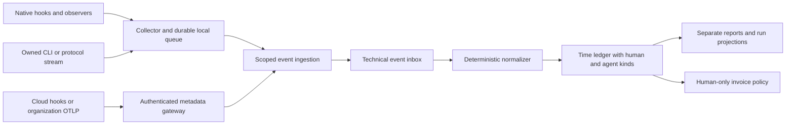

# Agent time tracking implementation plan

Status: proposed implementation specification. Research checked 12 October 2026. Repository baseline: `7d559fafe11db1997553a4fb184f41db1e70d4e2`.

Work Address should track human working time and agent execution time separately. This separation is the confirmed product requirement. Extend the existing `Time` domain, add a small collector with provider adapters, and ingest metadata through a scoped API. Use deterministic lifecycle signals where available; expose incomplete coverage where they are not. Do not make the language model responsible for remembering to start or stop the timer.

This plan covers Claude Cowork, Claude Code, Codex, current Kimi Code, legacy Kimi CLI, OpenClaw, NousResearch Hermes Agent, and an extension path for other runtimes. “Hermes” means NousResearch Hermes Agent; “Kimi” consumer Agent/Work support is a separate capability from its coding tools. Vendor capabilities below are supported by opened primary documentation, but no adapter has been installed or run as part of this research. All new APIs, fields, package names, limits, and rollout phases below are proposed Work Address contracts, not existing functionality.

## Product contract

- Preserve the current desktop tracker and its human activity records.
- Show **Human time** and **Agent time** independently. Never add them into a single “hours worked” or productivity score.
- Associate an agent run with an existing project and the human account responsible for its integration. A scheduled job can have an account owner without implying that person was working then.
- Show source product, execution surface, run outcome, measurement coverage, and whether the result is still provisional.
- Exclude agent records from invoices, paid/unpaid actions, and human hourly-rate calculations in the first release. Agent billing would require a separate product decision and explicit Invoice policy.
- Do not collect prompts, answers, reasoning, file contents, screenshots, tool arguments/results, or raw repository paths by default.
- Ordinary MCP timer tools may provide a manual fallback. They are not sufficient evidence of comprehensive automatic tracking.

## Integration findings

“Documented” means a primary source describes the surface. “Qualified” must mean our conformance tests pass on a recorded product version and deployment. None of these adapters is qualified yet.

| Product and surface | Documented capture route | Initial implementation choice | Qualification boundary |
| --- | --- | --- | --- |
| Codex local CLI and desktop runtime | Lifecycle hooks; app-server notifications; noninteractive JSONL; OTel | Native hooks for existing sessions; app-server or JSONL for runs controlled by an integrator | Pin surface/version and prove continuations, interruption, wait coverage, and hook trust |
| Claude Code | Hooks and optional OTel traces/metrics | Native hook adapter with optional trace enrichment | Stop hooks alone miss interruption and may allow continuation |
| Claude Cowork | Plugin hooks; Team/Enterprise OTel; cloud and legacy local execution | Separate cloud/local spike; metadata OTLP gateway where entitled | Exact lifecycle coverage and authenticated cloud egress must pass before claiming automatic run timing |
| Current Kimi Code | Hooks and experimental Server API | Hooks first; Server API for qualified richer observation | Current codebase, installed schemas, and cross-process visibility |
| Legacy Kimi CLI | Wire JSON-RPC transport | Optional separate adapter for explicitly launched legacy sessions | Archived codebase; separate compatibility package |
| OpenClaw | Typed plugin observers, diagnostic events, OTLP | Passive plugin/diagnostic adapter | Session attribution, external harness correlation, incomplete wait visibility |
| Hermes Agent | Python observer hooks | Passive observer plugin | Per-turn end semantics, delayed child callbacks, version-pinned observer contract |
| OpenCode | JS/TS plugin lifecycle events | Next native adapter after the named products | Verify start/status, permissions, and terminal payloads |
| Other agents and frameworks | Explicit SDK callbacks or qualified OTel spans | Small public emitter SDK and adapter interface | No claim that arbitrary MCP/OTel support provides full run lifecycle |

### Codex

The hook reference documents `UserPromptSubmit`, `Stop`, `Interrupt`, `SessionStart/End`, `SubagentStart/Stop`, tool hooks and `PermissionRequest`. Turn hooks expose `turn_id`; common input has `session_id`; subagent hooks use the parent session ID plus `agent_id`. `SessionEnd` is not a turn boundary. Stop hooks can cause continuation. Non-managed hooks need trust review, and transcript formats are explicitly unstable. Use a short, silent local enqueue handler; validate event-specific success output, including JSON for Stop. Do not parse transcript files for the production contract. [Codex hooks](https://learn.chatgpt.com/docs/hooks)

App-server exposes `turn/started`, `turn/completed`, item notifications, approval requests and `serverRequest/resolved`. Terminal turn status distinguishes completed, interrupted and failed. Generate schemas from the installed binary. This is a client protocol, not proof that an independent observer can attach to every existing desktop session. Prefer it when our integrator owns the connection. [App-server](https://learn.chatgpt.com/docs/app-server)

`codex exec --json` emits `thread.started`, `turn.started`, `turn.completed`, `turn.failed`, and item events. A wrapper must create a durable local run ID where the stream lacks one. It measures only its launched execution. [Noninteractive mode](https://learn.chatgpt.com/docs/non-interactive-mode)

OTel can enrich API/tool timings, but logs may contain tool-output snippets even when prompt logging is disabled. Sanitize before storage. Hook-bearing plugins currently require manual distribution rather than public directory submission. [Telemetry](https://learn.chatgpt.com/docs/config-file/config-advanced), [plugin distribution](https://developers.openai.com/plugins/deploy/submission)

### Claude Code

Hooks provide `UserPromptSubmit`, `Stop`, `StopFailure`, `SessionEnd`, tool lifecycle, `PermissionRequest`, subagent lifecycle and MCP elicitation events. Correlate `session_id`, `prompt_id`, `agent_id`, and tool IDs when present. `Stop` does not fire on user interruption and another hook may continue execution. Collector timestamps are needed when producer timestamps are absent. Cloud settings and local settings are separate deployment concerns. [Hook contract](https://code.claude.com/docs/en/hooks)

OTel's `claude_code.active_time.total` distinguishes `type=user` and `type=cli`; do not ingest their sum as agent time or import its user dimension as duplicate human time. Optional beta traces distinguish interaction, tool execution and time blocked on a user. `PermissionRequest` alone does not prove a human waited: another hook may resolve it. Require correlated blocking/resolution evidence. Trace enrichment must not duplicate hook records. [Monitoring](https://code.claude.com/docs/en/monitoring-usage)

### Claude Cowork

Current help explicitly supports plugin hooks in Cowork as well as Claude Code. It does not establish identical hook schemas. Cowork is cloud-default with legacy local execution; cloud tasks generally cannot reach private addresses. Therefore a host-loopback-only collector is insufficient. Qualify a plugin running in its actual execution environment with outbound authenticated HTTPS, or an organization telemetry receiver. [Plugin support](https://support.claude.com/en/articles/13837440-use-plugins-in-claude), [architecture](https://support.claude.com/en/articles/14479288-claude-cowork-architecture-overview)

Team/Enterprise OTel setup covers cloud and legacy local deployments. The monitoring reference includes `session.id`, `prompt.id`, event timestamps/sequences and API/tool durations, but does not establish complete turn and waiting pairs. An `assistant_response` may be intermediate. Report **observed API/tool activity** for OTel-only coverage; never silently call it whole-task runtime. The setup and reference differ in their treatment of cloud/local execution, so validate the selected deployment. Strip content and unnecessary personal identity fields; retain allowlisted session/prompt/event correlation IDs and map account ownership through the credential. [OTel setup](https://support.claude.com/en/articles/14477985-monitor-claude-cowork-activity-with-opentelemetry), [event reference](https://claude.com/docs/cowork/monitoring)

If automatic lifecycle collection fails qualification, ship an explicit manual timer marked `manual`, with a visible integration status. Do not advertise automatic Cowork run timing until that gate passes. Plan entitlement and cloud connectivity are setup prerequisites, not assumptions shared with Claude Code.

### Kimi Code and legacy Kimi CLI

The legacy `MoonshotAI/kimi-cli` repository directs users to `MoonshotAI/kimi-code`. Use separate adapter IDs. [Legacy repository](https://github.com/MoonshotAI/kimi-cli), [current repository](https://github.com/MoonshotAI/kimi-code)

Current Kimi Code hooks include `TurnStarted`, `Stop`, `StopFailure`, `Interrupt`, `PermissionRequest/PermissionResult`, subagent events and an optional `SessionHeartbeat`. Prefer `TurnStarted` so scheduled/system turns are covered. Heartbeats prove liveness, not execution. `Interrupt` covers user interruption, not timeouts/programmatic abort; `SubagentStop` documents successful completion. Failed children require another qualified signal or remain unknown. Stop continuation requires fixtures. [Current hook contract](https://moonshotai.github.io/kimi-code/en/customization/hooks)

The experimental Server API documents `/api/v1/meta`, `/api/v1/ws`, timestamps, session identity, turn/approval/question/subagent events and durable replay using `{seq,epoch}`. Volatile events are not replayable. Recovery beyond the documented 1,000-event buffer needs a snapshot and resubscription. Use the installed `/openapi.json` and `/asyncapi.json`; some reads can resume a cold session, and cross-process observation is not necessarily immediate. Do not start or resume work just to track it. [Server API](https://www.kimi.com/en/help/kimi-code/cli-server-api)

Legacy Wire uses `TurnBegin`, `TurnEnd`, interruptions and nested subagent events. Negotiate its protocol; do not reuse current Kimi mappings. Neither coding integration establishes support for the consumer Kimi app. [Legacy Wire](https://moonshotai.github.io/kimi-cli/en/customization/wire-mode.html)

### OpenClaw

Use typed plugin observers and diagnostic subscriptions, rather than treating `HOOK.md` automation hooks as equivalent. Session hooks describe session lifetime; `agent_end` and run diagnostics are more appropriate run signals. Child hooks use different field names for the child identity at spawn and end. Observer enqueue work must remain bounded. [Hook reference](https://docs.openclaw.ai/plugins/hooks/reference)

Diagnostics include `harness.run.started/completed/error`; spans include `openclaw.run`, `openclaw.harness.run`, model and tool execution. Some progress signals are direct-only. Default exported telemetry omits session keys, so OTLP alone does not guarantee project attribution. [Spans and events](https://docs.openclaw.ai/gateway/opentelemetry/spans-and-events), [telemetry privacy](https://docs.openclaw.ai/gateway/opentelemetry/privacy-and-trace-context)

Use available run identity and input provenance; a trigger labelled `user` need not be an external human. Model-call telemetry is not uniform across embedded and external harnesses. Universal passive human-wait boundaries are not established here. Do not request approval-control privileges merely to measure time. [Prompt and session hooks](https://docs.openclaw.ai/plugins/hooks/prompt-and-session)

An OpenClaw run invoking Codex may be observed by both adapters. Configure an authoritative source for that execution and link orchestration provenance. Never deduplicate using timestamps alone.

### Hermes Agent

The observer contract `hermes.observer.v1` supplies session/turn IDs, `pre_llm_call`, `on_session_end`, tool/API events, subagent events, and `on_human_input_request/resolved` with request identity. Human-input events do not establish universal turn/tool correlation: prove the owning run and blocking scope before claiming complete wait coverage. Prefer callbacks returning `None`, accepting future keyword arguments and failing open. [Observer contract](https://github.com/NousResearch/hermes-agent/blob/main/website/docs/developer-guide/observer-hooks.md)

Despite its name, `on_session_end` runs at the end of each conversation turn, including failure/interruption. Pair it with `pre_llm_call`, not the new-conversation `on_session_start`. Start occurs after context compression, so coverage is observed turn runtime rather than full request latency. Child stop callbacks can arrive after child futures drain. Native duration must have a source start/end anchor to join a wall-time union; do not anchor it at callback receipt. Plugins require explicit enablement. [Hook semantics](https://github.com/NousResearch/hermes-agent/blob/main/website/docs/user-guide/features/hooks.md), [plugins](https://github.com/NousResearch/hermes-agent/blob/main/website/docs/user-guide/features/plugins.md)

### Other systems

OpenCode documents `session.status`, `session.idle`, `session.error`, permission and tool events, with project/worktree context. It is a reasonable next adapter, subject to payload and replay qualification. [OpenCode plugins](https://opencode.ai/docs/plugins/)

For custom frameworks, expose our versioned event emitter SDK. OTel is an optional input transport: normalize verified agent spans and preserve trace/span IDs. GenAI agent semantic conventions are still marked Development; pin their schema and distinguish agent spans from nested model/tool spans. Never sum every span in a trace. [OpenTelemetry agent conventions](https://github.com/open-telemetry/semantic-conventions-genai/blob/main/docs/gen-ai/gen-ai-agent-spans.md)

## Measurement rules

A **session** is a persistent conversation. A **run** is one execution turn, including its internal model/tool loop. A **child run** is a separately identified subagent execution. Resuming a chat does not join the idle gap into either run.

| Measure | Definition | Display rule |
| --- | --- | --- |
| Human tracked time | Existing Time records and activity semantics | Preserve current behavior; never infer from agent messages |
| Agent elapsed time | Union of observed run envelope intervals in the selected grouping, including waits within them | Label elapsed; incomplete boundaries produce bounded/partial results |
| Agent runtime | Union of execution intervals with complete external-wait classification | Available only for qualified coverage; otherwise null, not zero |
| Known human-wait time | Union of explicitly paired approval/input waits per run | Partial coverage must be labelled; one blocked tool does not pause independent work |
| Summed agent runtime | Sum of per-agent-instance runtime unions | Can exceed wall time; parent intervals may include child orchestration, so this is not compute utilization |
| Observed API/tool activity | Union of timestamped API/tool spans from a partial source | Keep separate from whole-run runtime and elapsed |

All calculations use integer milliseconds and half-open intervals `[start,end)`. Store UTC; use the selected reporting timezone only for bucketing. Clip intervals to the requested period before unioning. Do not round each event to minutes. Native duration and monotonic collector time take precedence over callback-arrival differences when they can be tied to the same clock domain. Preserve precision/clock provenance; reject impossible negative intervals.

Model inference, tool execution, network latency and retries remain within runtime. Queue time before execution, explicit waiting for a person, idle time between turns, and unobserved gaps do not. An internal wait for a child may still be part of the parent's observed runtime; only an adapter that proves its state may subtract it. CPU time, token count, cost and “time saved” are outside this metric.

**Concurrency example:** agent A runs 10:00–10:10 and B runs 10:05–10:15 with complete coverage. Union runtime is 15 minutes; summed runtime is 20 minutes. If the human tracker reports 12 minutes, display Human 12 minutes and Agents 15 minutes, with summed runtime as a separate detail. Do not report 27 or 32 minutes as human work. Across contributors, label the union as project wall time; per-person unions are not additive.

**Coverage example:** a run lasts ten minutes with a known two-minute approval wait. A complete adapter reports eight minutes runtime and two minutes waiting. An adapter that may miss other waits reports ten minutes elapsed, two minutes known waiting, and runtime unavailable. No silent estimate fills the missing classification.

For partial API/tool telemetry, overlapping nested spans count once within the observed-activity union. A duration without a trustworthy anchor can support a separately labelled duration sum but cannot join wall-time union metrics; retain it as technical evidence only in the first release.

## Fit with the existing application

Paths in this document are relative to the repository root. [SPEC.md](../SPEC.md) defines five domains and makes Time the only work ledger. Agent records remain Time records. Do not introduce an AgentSession, Timesheet, Workspace or synthetic agent User business domain.

| Existing path | Current constraint | Implementation requirement |
| --- | --- | --- |
| `api/src/entity/time.ts` | Unique project/start timestamp; required keyboard/mouse fields | Add Time kind, agent identity and interval data; separate agent uniqueness; nullable human-only fields |
| `api/src/service/time-manager.ts` and `repository/time-repository.ts` | Desktop upsert uses project/from/to | Explicitly restrict existing writes and lookup to human records |
| `api/src/repository/time-repository.ts` | Totals sum all rows and derive human rate totals | Guard legacy totals and searches with human kind before any agent ingestion |
| `api/src/service/invoice-manager.ts` | Prices `minutesActive`; selected and period candidates | Reject agent IDs and filter every candidate, summary and paid/unpaid mutation |
| `api/src/service/project-statistics-manager.ts` | Aggregates operating-system processes | Agent summaries query Time; never encode agents as fake process entries |
| `api/src/service/auth/authenticator-time-tracker.ts` | IP-bound pairing returns ordinary user tokens | New scoped collector credential; no reuse of unrestricted user token flow |
| `api/src/app/app.ts` and `app-container.ts` | Explicit controllers and DI; global 30 MB JSON parser | Register new services/controllers; enforce lower ingestion body limits before the global parser |
| `api/src/connector/db-connector.ts`, `ormconfig.ts`, `api/package.json` | Migration glob exists but no established migration files/runner | Add explicit non-destructive migration tooling and upgrade tests |
| `web/src/features/time/model/time-grid.ts` | Assumes human activity percentages and daily sums | Separate agent view; no keyboard/mouse percentages for agents |

There is a preexisting discrepancy between free collaborator access in SPEC and premium checks in some project helpers. Centralize the intended owner/worker/viewer checks for agent ingestion and test them against SPEC; do not invent a premium requirement for this feature. Broad cleanup of unrelated access paths can be a separate change. Likewise, the existing difference between wall-time rate totals and invoice active-minute pricing should not be expanded to agent records.

## Architecture



Use the current API and PostgreSQL deployment. Redis may wake workers or cache health but is not the authoritative queue or clock. Start with a PostgreSQL event inbox and worker lease; no Kafka or new service cluster is required. The cloud metadata gateway can be a route/worker in the same backend initially, with its own protocol decoder and size limits.

The collector is a small Node/TypeScript package under `packages/agent-tracker`, with minimal Python shims for Python-only observers. It runs alongside the agent, not necessarily on the user's laptop. Its local queue uses transactional SQLite or an equivalently tested crash-safe spool. Packaging/runtime choice must be demonstrated on supported platforms in Phase 0; do not assume a remote sandbox can access the host's filesystem or socket.

Local hooks synchronously sanitize and enqueue with a short deadline, then return the provider-specific success response. Upload runs independently. A telemetry failure must not block, approve, cancel or modify the user's agent work. Only use asynchronous vendor hooks if their cancellation/order behavior meets the reliability tests. Do not send log text on a protocol's stdout.

## Canonical data model

Choose **one Time row per agent run**. Its envelope and canonical classified intervals live on that row. Sessions, run trees and live status lists are projections. This keeps all recorded time in Time while allowing a single row to distinguish running, waiting and unknown spans.

### Time extensions

| Field | Proposed shape and rule |
| --- | --- |
| `kind` | `human` or `agent`; default/backfill `human` |
| `fromAt`, `toAt` | Existing UTC fields; agent envelope from observed start to terminal or last defensible evidence; never move `toAt` to current wall time on a read |
| `user`, `project` | Existing relations; author derives from credential, project validated server-side |
| `sourceSystem`, `sourceSurface` | Stable enum/registry IDs such as `codex` plus `desktop`, `cli`, or `cloud`; distinguish `kimi-code` from `kimi-cli` |
| `sourceInstanceId` | Registered collector/source namespace, stable across credential rotation |
| `sourceSessionId`, `sourceRunId`, `sourceAgentId` | Opaque source identities; required run ID may be collector-generated with `identityOrigin=collector` |
| `parentSourceKey` | Nullable structured source/run identity for delegation; optional `executionKey` correlates the same execution through multiple harnesses |
| `agentStatus` | `running`, `waiting`, `completed`, `failed`, `cancelled`, `unknown`; keep failure reason to an allowlisted code |
| `agentSegments` | Ordered nonoverlapping intervals within envelope: `{fromAt,toAt,state,evidence}` where state is `running`, `human_wait`, or `unknown` |
| `agentMeasurement` | Versioned metadata: `coverage=run|activity_only|manual`, wait coverage, time basis, boundary quality, provisional flag, adapter/runtime/schema versions, normalizer revision |
| `sourceRefs` | Minimal event/cursor references needed for diagnostics and revision; no transcript path or body |

For agent records, `minutesActive`, keyboard/mouse metrics, screenshot and processes are null; do not synthesize zeros to pretend that agent work is idle human work. Keep human validation intact. Agents have `isPaid=false` and no invoice relation. Enforce the same invariants in validation and database constraints where practical.

Replace `UQ_PROJECT_FROM_AT` with a human-only partial unique index preserving the existing human behavior. The canonical run key is `(userId, sourceSystem, sourceInstanceId, sourceSessionId, sourceRunId, sourceAgentId)`, with a non-null root agent identity and a stable synthetic session namespace where the source has none. Use it for the unique index, locks, lookups, parent keys and enrichment. If native run IDs reset within a session, namespace them with the producer epoch. Project is immutable for a run, so excluding it from this key prevents counting the same run in two projects. Future reassignment must be an audited move. Do not change human collision behavior incidentally.

Source IDs need bounded length, stable encoding and case-sensitive comparison. Add query indexes covering project/kind/fromAt, user/kind/fromAt, source run lookup, and provisional run reconciliation. Do not index every JSON field. Validate segment order, nonnegative length and containment in application code; coalesce adjacent segments with identical state/evidence. Proposed limit: 10,000 segments per run; above it mark coverage incomplete and surface an actionable error rather than truncate silently.

### Technical persistence

These are infrastructure records under User and Time, not additional hour or money ledgers:

- `AgentCredential`: hashed secret, owning user, permitted project, source instance, allowed adapters, scope, expiry, revocation and last use. No hours.
- `AgentEvent`: immutable, metadata-only envelope, server receipt time, payload hash, processing status and retry/error code. No independently authoritative duration total.
- `AgentSourceCursor`: source epoch/cursor, worker lease and last contiguous committed watermark. Never advance a stream watermark past an unprocessed event belonging to another run. No reported hours.
- Required normalizer checkpoint before evidence compaction: canonical run key, projection revision, event-time watermark, source/clock epochs, sequence watermarks, last proven state/time, outstanding run-blocking request set, unresolved branch correlation, dedupe state and metric authority. It resumes normalization from Time's frozen interval prefix plus retained events; it is not a second duration ledger.

Keep event evidence while needed for repair, then retain canonical intervals and compact provenance in Time. Purging events must not erase the ability to interpret existing Time values. Corrections after the replay window require a deliberate audited operation, not recomputation from a partial log.

## Event contract

Create a versioned Work Address schema shared by collector, server and fixtures. Strictly reject unknown payload fields at the public ingestion boundary. Provider adapters transform input locally before submission.

```json
{
  "schemaVersion": 1,
  "eventId": "2b9f4e38-5a8f-4455-81cc-15ff91f5c88b",
  "source": {
    "system": "codex",
    "surface": "cli",
    "instanceId": "collector-registered-id",
    "adapterVersion": "0.1.0",
    "runtimeVersion": "qualified-version",
    "epoch": "process-boot-id",
    "sequence": 42
  },
  "projectId": "7f82d6f0-87d6-4e50-a55c-02be7ce7b240",
  "sessionId": "opaque-session-id",
  "runId": "opaque-turn-id",
  "agentId": "root",
  "eventType": "run.started",
  "occurredAt": "2026-10-12T09:00:00.000Z",
  "observedAt": "2026-10-12T09:00:00.004Z",
  "clock": {
    "basis": "collector_monotonic",
    "bootId": "process-boot-id",
    "monotonicMs": 185004
  },
  "capabilities": {
    "runBoundaries": true,
    "externalWaits": "partial",
    "replay": false
  }
}
```

The sample is our proposed envelope, not a vendor payload. `occurredAt` uses source time when trustworthy, otherwise collection time with the correct basis. Server sets `receivedAt`; clients cannot supply user identity or authoritative billing fields. Register capabilities against a qualified adapter version; do not trust arbitrary clients to upgrade their quality classification.

Normalized types are `run.started`, `run.completed`, `run.failed`, `run.cancelled`, `wait.started`, `wait.ended`, `run.observed`, and `activity.observed`. Define them as a discriminated union with conditional required fields, not an unrestricted metadata bag:

| Event data | Required contract |
| --- | --- |
| Run observation | `observedState=running|human_wait|unknown`, `evidenceKind=runtime_state|lifecycle|native_span`; `human_wait` references known blocking request IDs |
| Wait events | `requestId`, `waitScope={kind:run|tool|child,scopeId}`, optional proven `toolCallId`/`childSourceKey`; resolution outcome may be `unknown` |
| Native timing | Optional `sourceDurationMs` as a nonnegative integer, `durationBasis=source_monotonic|source_wall`, optional `sourceStartedAt`/`sourceEndedAt`; source clock identity required |
| Observed activity | `activityKind=model|tool`, `activityId`, anchored `sourceStartedAt`/`sourceEndedAt`; reject inconsistent timing beyond documented source precision |
| Provenance | Optional `parentSourceKey`, `executionKey`, `sourceCursor`, `outcome`; each with a bounded explicit schema |

Adapters normalize vendor duration units to milliseconds. Duration-only evidence is not `activity.observed` and cannot establish interval placement. An activity-only projection uses a deterministic synthetic run key when no native run correlation exists. Later proven run evidence enriches or transactionally aliases that projection, excluding the secondary row from totals; uncorrelated activity stays separate. Never claim elapsed time across gaps between isolated activity spans.

`waitScope` identifies the whole run or a tool/child. The normalizer pauses the whole run only with evidence that no independent work continues. Multiple outstanding run-blocking waits form a set keyed by request ID: the first opens a waiting interval and the last resolved request closes it. A cleared request is not automatically permission granted. A proven terminal boundary closes unresolved waits; preserve an explicit supplied outcome, otherwise record terminal-derived closure with unknown outcome.

`run.observed` means the adapter positively observed this run's current execution state. Collector, process and session heartbeats are health signals, not this event. Model-emitted timer calls use `coverage=manual` or an explicitly estimated quality; they cannot claim native observation.

Generate `eventId` before a durable enqueue and reuse it for retries. For replayable native streams, derive stable identity from source namespace, epoch and native event ID/sequence. For hooks without an event ID, use source invocation identity where available; otherwise assign a UUID once and deduplicate downstream transitions by run/request identity. Do not collapse distinct events merely because their JSON or timestamp matches.

## Normalization and failure recovery

Implement `AgentTimeNormalizer` as a deterministic class with an injectable clock and fixture-driven tests. Order by native source sequence within a proven stream/epoch; otherwise use source time, causal identities and collector ordering. Never impose one global sequence across concurrent processes.

1. Validate identity, credential, project access, bounds, schema and payload hash; persist the event transactionally before acknowledging acceptance.
2. Serialize normalization by canonical run key using PostgreSQL locks/leases. A worker crash must leave durable unprocessed events claimable by another worker.
3. On a start, create/upsert the Time projection. If wait coverage is complete, open running state; otherwise classify unproven spans as unknown while preserving the elapsed envelope.
4. Apply explicit wait/resume/observation events and terminal outcomes. Stop-hook attempts are adapter candidates until continuation semantics are reconciled; do not equate “Stop hook called” with durable final completion.
5. Commit the Time revision and processed-event cursor together. Replay of any acknowledged event must produce the same result.
6. Mark unsupported, missing or contradictory evidence as partial/unknown; surface a diagnostic. An error notification alone is not always terminal because runtimes retry.

Publish provisional projections immediately; use a proposed 60-second grace period for routine reordering/finalization, not a processing delay. The upload and correction horizon is seven days of event age, further limited by project retention. Reject events before the run's compacted watermark or that horizon with `REVISION_WINDOW_EXPIRED`; unlimited canonical Time retention does not mean unlimited event replay. Late accepted events trigger deterministic suffix revision from the required checkpoint and all retained evidence, preserving the frozen prefix in Time. UI summaries carry a revision and invalidate after correction. A terminal before its start remains pending, never a guessed duration. Conflicting terminals are quarantined unless the adapter defines an authoritative correction rule.

Proposed liveness settings for capable adapters: observe every 15 seconds and mark a run stale after 90 seconds without evidence. Staleness closes counting at the **last proven timestamp**, not at the end of the 90-second timeout. A live collector does not fill that gap. Sparse hook adapters may later reconcile a valid start/end envelope, but cannot claim active/wait coverage that was never observed. UI may show “running, last observed 2 minutes ago”; it must not persist an ever-growing duration from a stale timer.

On suspend, reboot, disconnect or runtime crash, preserve the open record as unknown/provisional and stop extrapolation. A restarted collector uses a new clock epoch; monotonic values are never compared across boots. Detect large wall-clock reversals and future timestamps; quarantine rather than silently correcting them. Proposed future-skew tolerance is five minutes, configurable and tested.

For a missing stop, do not invent success. A stopped child does not stop its parent, and a stopped parent does not prove all children stopped. Continued autonomous work needs its own documented continuation/start signal. Prefer source durations for delayed child completion, but only anchor intervals when source evidence supports that anchor.

For nested harnesses, persist a validated alias relation between canonical run keys and one designated authority per metric on the Time provenance/configuration. `executionKey` is that relation, not an arbitrary client claim. Secondary observations enrich the authority; different children remain distinct. When correlation is unavailable, setup must select one authoritative adapter for the overlapping execution surface and suppress the other from combined metrics. Do not guess duplicate rows from similar times. This is especially relevant to OpenClaw driving Codex or Claude Code.

## API and authentication

All routes below include the application's `/api` prefix. They are new contracts.

| Route | Auth and behavior |
| --- | --- |
| `POST /api/agent-tracking/credentials` | Existing signed-in user; issue a project-scoped write-only secret, shown once |
| `GET /api/agent-tracking/credentials` | Existing signed-in user; own credential metadata only, never secret |
| `DELETE /api/agent-tracking/credentials/:id` | Owner revokes credential; next request fails immediately |
| `POST /api/agent-tracking/events` | Dedicated collector auth; metadata event batch; cannot authenticate to ordinary user routes |
| `POST /api/agent-tracking/search` | Existing user auth and Project visibility rules; grouped run projection, cursor pagination and filters |
| `POST /api/agent-tracking/summary` | Existing user auth; separate agent metrics with coverage/revision and explicit grouping |
| `GET /api/agent-tracking/status` | Existing user auth; own connection health, queue/error summaries and qualification status |

Credential creation body specifies one project, source instance and allowed adapter IDs. A worker can create a credential for their own authorized tracking; a viewer cannot. Derive event author from the credential, recheck current project membership/state each batch and on processing, and scope status/search access independently. Project owner, workers and viewers see project time according to SPEC; collector secrets and private machine mapping stay with their owner. Revocation and removed membership invalidate queued unauthorized writes.

Use random 256-bit opaque secrets, store only a secure hash plus lookup prefix, and redact Authorization in logs. Proposed default expiry: 90 days, with user-visible renewal and overlap for rotation. Bind to a stable source instance independent of token IDs. Local secrets belong in the OS credential store or a permission-restricted config, never a checked-in hook file. A cloud sandbox receives a short-lived, project-limited credential through its supported secret mechanism; do not pass ordinary Work Address JWTs through prompts.

For the initial release, browser settings can issue the secret and the collector's setup command can read it through secure input. A future device flow must bind pairing by a one-time code/state, not shared IP. Never expose a local agent-control server on the public internet to make tracking work.

The ingest request body is `{events: AgentEventV1[], health?: CollectorHealthV1}`. Health permits only nonnegative queue/rejection/loss counts and the last successful upload timestamp; allow an empty events array when reporting health. Health updates connection status but never create or extend Time. Rate-limit health-only requests separately to one per 30 seconds. Do not include local filenames, secrets or error payloads.

Proposed event limits: 100 events per batch, 1 MiB uncompressed body, 16 KiB per normalized event, 300 events/minute per credential with a 600-event burst. Make limits configurable; event capture should coalesce health observations rather than upload token/text deltas. Enforce limits before expensive decode and before the global large-body JSON parser. OTLP needs equivalent compressed and expanded byte limits.

Successful transport returns one result per event:

```json
{
  "results": [
    { "eventId": "event-a", "status": "accepted" },
    { "eventId": "event-b", "status": "duplicate" },
    { "eventId": "event-c", "status": "rejected", "code": "PROJECT_ACCESS_DENIED" }
  ]
}
```

`accepted` means durably stored, not already visible in summaries. Reuse of an event ID with a different canonical payload returns `EVENT_ID_CONFLICT` and never overwrites the event. An invalid envelope produces HTTP 400; oversized batches 413; bad/expired credentials 401; invalid credential scope 403; throttling 429 with Retry-After. Retry network/429/5xx with exponential backoff and jitter. Do not endlessly retry permanent schema/access/retention failures. Preserve rejected items in a bounded local diagnostic queue with a visible resolution path.

The deduplication unique key is `(sourceInstanceId,eventId)` under its owning user. The inbox, cursor, projection update and receipts must survive an API restart. Cross-user collisions never reveal whether another user's event exists.

## Project attribution and privacy

Mapping precedence is explicit run override, explicit session mapping, then an exact user-approved workspace mapping. A machine default is opt-in. Never select a project using prompt text, a model guess, or a fuzzy repository-name match. Freeze mapping when a run starts. Unknown mapping leaves events locally pending for assignment and starts no remote project record.

Resolve Git worktrees to a stable local workspace identity, but let users override it. Keep paths and remote URLs local; send a random workspace alias or keyed hash if necessary. A task spanning projects must explicitly create separate attributed runs/segments through a later supported workflow; do not duplicate its full duration into each project.

Metadata allowlist: bounded source IDs, version, model identifier if enabled, event type, timestamps/durations, status, parent linkage, project ID, confidence and opaque cursor. Drop emails, names, tool text, commands, titles derived from prompts, URLs, environment variables and file paths before enqueue. Render remaining labels as plain text. OTLP receivers should discard disallowed fields in memory without body logging, tracing payload capture or error-report attachments.

Scope is user-authorized observability. A signed or authenticated event proves its source credential, not that the duration is trustworthy enough for payroll. No tamper-proof labor claim is made. Keep tracking disablement and credential revocation straightforward; uninstall only the integration's own hooks without changing unrelated user configuration.

Proposed local queue cap: 100 MiB or seven days, whichever is reached first. Never discard without incrementing a visible loss counter. Preserve compact lifecycle events ahead of optional activity enrichment; once required events are lost, mark affected runs incomplete. Files use owner-only permissions; use OS-backed encryption when the selected spool supports it and document platform coverage.

Canonical agent Time follows project-owner retention: hosted free projects keep the existing 14-day window; self-hosted entitlement remains unlimited. Restrict legacy `softDeleteExpiredEntriesForProjects` to human records: its start-time predicate would otherwise delete a long agent run containing recent work. A separate periodic agent retention pass clips expired segments and the envelope to the cutoff, sets `truncatedByRetention`, and preserves only the identity/checkpoint needed for surviving work. No summary may reconstruct purged hours from an original start timestamp. Remove the row when no retained work remains, while retaining necessary technical open-run state.

The seven-day correction horizon is separate from canonical retention. Before pruning an inbox prefix, atomically checkpoint every affected run at a watermark no newer than the oldest event still eligible for correction, accounting for allowed clock skew. Keep every required event after that watermark. Compact only after the checkpoint and frozen Time prefix commit; a generic TTL must not delete evidence independently. If safe compaction fails, preserve the evidence and alert. Reject corrections older than the advertised watermark. Never acknowledge an expired upload as synced, and do not silently purge unprocessed events. Project/user deletion removes associated evidence and credentials; minimal hashed tombstones prevent replay resurrection within the supported horizon. Deleting an active run also suppresses subsequent observations for that source run until its terminal boundary and correction window pass.

## User experience

Add an **Agent tracking** setup section within existing project/account settings. Show adapter product and surface, tested version, project mapping, last event, last upload, queued/rejected count, credential expiry and coverage. “Connected” alone is insufficient: distinguish configured, awaiting hook trust, healthy, partial, stale, unsupported version and revoked.

Keep human worklogs as the default existing view. Add an **Agents** view with run grouping and filters for project, responsible user, product, surface, date, status and coverage. Display start/end, elapsed, runtime where qualified, known waits, child relationships and provisional/error labels. Use a neutral “Unavailable with this integration” for missing runtime; never show zero as a substitute. Activity-only and manual rows must be visibly distinguished.

Dashboard and export return separate human and agent sections. Show agent union runtime only alongside its coverage fraction/count and the measurement definition; a subset of qualified runs must not look like a complete total. Agent rows have no screenshot, keyboard/mouse activity bars, mark-paid or invoice-selection actions. Add explicit empty, connecting, no-project, offline, permission-revoked and unsupported-version states.

Use the repository's Effector/Farfetched data flow, Feature-Sliced Design, styled-components and shared UI components. No API calls from components and no extra domain slice that owns a competing time ledger. Existing Time API entities can hold the new read models.

## Implementation sequence and file plan

Each phase has a reviewable exit condition. Phase 0 validates external contracts; core implementation can proceed with synthetic fixtures while vendor spikes run independently. Do not claim a connector supported solely because documentation exists.

| Phase | Work | Exit condition |
| --- | --- | --- |
| 0 | Capture sanitized lifecycle fixtures for every named product; record version, OS/deployment, schema hash, wait/replay coverage and install method | Compatibility manifest distinguishes qualified, partial and unsupported modes; Cowork cloud proof and current Kimi identity resolved |
| 1 | Time specialization, migration tooling, human filters, invoice defenses, scoped auth and event schema | Legacy desktop ingestion, totals and invoices unchanged in migration/regression tests; agent writes still feature-disabled |
| 2 | Durable inbox, deterministic normalization, local spool, ingest/read APIs and synthetic adapter | Replay, crashes, ordering, retention, concurrency and tenant isolation tests pass |
| 3 | Codex and Claude Code native adapters; setup and Agents UI | Real normal/interrupted/waiting/offline runs visible with truthful coverage; human totals unchanged |
| 4 | Current Kimi Code, OpenClaw and Hermes adapters; Cowork qualified hook/cloud or partial OTLP path | Every named product has a tested mode or explicit unavailable/partial status; no broad automatic-support claim for gated modes |
| 5 | OpenCode, generic emitter SDK, optional OTel and legacy Kimi adapter | Adapter conformance harness reusable without changes to core Time accounting |

Proposed additions:

- `packages/agent-tracker/`: CLI setup/status/uninstall, source registry, local queue, secure credential access, transport and adapters. `src/adapters/{codex,claude-code,claude-cowork,kimi-code,kimi-cli,openclaw,hermes}/`; metadata-only fixtures adjacent to tests. Add packages to actual workspace/build/release plumbing as required.
- `packages/agent-tracking-contract/`: versioned schema/types, canonical identity and adapter capability definitions. Keep server domain logic in Manager classes; do not scatter helper functions contrary to repository conventions.
- `api/src/controller/agent-time-controller.ts`, `agent-tracking-credential-controller.ts`; `model/dto/agent-time.ts`; `service/agent-time-manager.ts`, `agent-time-normalizer.ts`, `agent-event-worker.ts`; dedicated auth service/decorator; technical event/credential/cursor entities and repositories.
- `api/src/migrations/<timestamp>-agent-time-tracking.ts`, explicit migration scripts/config, and upgrade fixtures. Register entities/controllers/DI through existing application composition.
- `web/src/features/agent-tracking/` for setup and agent view; query/store additions under existing `web/src/entities/time/`; project settings and dashboard composition reuse existing pages.

Required modifications include Time entity/model/DTO, `TimeManager`, `TimeRepository`, `InvoiceManager`, statistics queries where necessary, application/container registration, database config, and generated clients. Add a short clarification to SPEC that agent measurements specialize Time and are excluded from human invoices; retain all five domains.

Every legacy path must set or filter `kind=human`, including search, getTotals, timestamp upsert, statistics, legacy retention purge, selected/unpaid/period invoice candidates, invoice summaries, and individual/bulk paid edits. Agent fields must not be mass-assignable through human create/edit DTOs. Human routes must reject attempts to mutate an agent row even when its author owns it. Agent corrections use a dedicated authenticated, audited path after MVP; do not expose raw projection mutation to collector tokens.

### Migration and rollout

1. Add nullable agent metadata and `kind` with human default; backfill existing rows, add constraints and read indexes. Preserve timestamps, author, invoice links and paid state exactly.
2. Deploy human-only query/mutation defenses while no agent writes are enabled. Replace old uniqueness with a human partial index and add agent source identity uniqueness after validating existing data.
3. Enable the inbox/worker behind `AGENT_TRACKING_ENABLED`, then selected qualified adapters behind independent flags. Observe projection lag and human invoice regression fixtures before widening rollout.
4. Roll back by disabling agent writes/UI and stopping the worker. Keep schema and data; do not run a destructive down migration or an old backend that lacks kind filters against mixed Time records.

Use explicit migrations, not production `schema:sync`. Test both an empty install and upgrade from a populated legacy schema. In-place human filters are a mandatory deployment boundary, not a follow-up task.

## Acceptance tests

| Scenario | Required result |
| --- | --- |
| Normal start, wait, resume, completion | Correct interval boundaries, outcome and coverage; wait excluded only when proven |
| Duplicate batch and lost acknowledgement | Exactly one event/projection effect; conflicting payload hash rejected |
| Same timestamp, two agents and one human | Independent records; human upsert cannot find or overwrite an agent |
| Terminal before start; late wait events | Pending/revised deterministic projection; no invented start |
| Run crash, collector crash, machine suspend/reboot | Stale count stops at last evidence; restart replay has no inflated gap |
| Stop hook continued by another hook | Continued work represented correctly; premature completion repaired or withheld |
| Manual approval and two concurrent waits | Request set handled; resolving one does not resume a still-blocked run |
| Parallel tool/child continues during one approval | Whole run not paused merely because one branch waits |
| Ten-minute overlapping A/B example | Union 15 minutes, sum 20 minutes; human total unchanged |
| Missing wait visibility | Elapsed available, runtime null/partial; never false exactness |
| Parent plus child plus OpenClaw wrapper | Correct lineage and authority; no duplicate execution count |
| Hook plus OTel on the same run | One run projection; nested spans enrich rather than add extra work |
| Protocol epoch changes and exhausted replay buffer | Snapshot/gap handling; unsupported history marked incomplete |
| Cross-project IDs, forged author, viewer token | Rejected without data disclosure or general account access |
| Revoked/expired token and removed membership | No new writes accepted/processed; safe local error state |
| Ordinary HTTP routes called with collector token | Authentication rejected; credential cannot view invoices or mutate projects |
| Human invoice selected/period/all/paid paths | Agent rows excluded or explicitly rejected, including mixed-ID requests |
| Project retention and self-hosted mode | Correct owner-based policy; old rejected uploads never reported as synced |
| Long run crosses retention cutoff | Agent intervals clipped; unrelated desktop upload cannot delete recent agent work |
| Evidence compaction then late correction | Checkpoint plus retained suffix produces the same result; older corrections rejected |
| Deletion followed by replay | No resurrection inside supported dedupe/replay horizon |
| Prompt/tool secrets present in vendor payload | Removed before local queue, request logs, inbox and diagnostics |
| Legacy migration with invoice links | Identical human totals, amounts, paid state and relationships |
| Timezone/day boundary and clock reversal | Correct clipped unions; ambiguous clocks produce diagnostics |
| Disk full, queue limit, unknown vendor version | Agent work continues; tracking loss/unsupported status visible |

Use table-driven normalized traces, provider contract fixtures and property tests for interval union, nonnegative duration and replay equivalence. Add integration tests for transactions/auth/migrations and focused UI tests for coverage and human/agent separation. Real-product smoke tests must record exact versions and deployment surfaces, with sanitized fixtures committed to the adapter package.

Existing verification entry points are `pnpm --filter ./api test`, `pnpm --filter ./api build`, `pnpm --filter ./web test`, `pnpm --filter ./web build`, and `pnpm --filter ./web lint`. Regenerate clients using `pnpm codegen:api-client` and `pnpm --filter @app/api-client codegen:web`; never hand-edit generated code. Add collector/contract tests and migration upgrade commands when those packages/tooling exist. Do not label these checks passed until implementation runs them.

Proposed operational targets: p95 local enqueue below 50 ms, hard capture deadline 250 ms; healthy online events visible within 30 seconds; replay converges without duplicate time; no unbounded live timer growth. Benchmark on representative supported machines before setting release guarantees. Monitor ingestion rejection rate, queue age, projection lag, stale runs, coverage, identity conflicts and dropped events without high-cardinality prompt/user labels.

## Handoff instructions for an implementation agent

Read this plan, root SPEC, backend/frontend skills and existing tests first. Implement Phase 1 and the Phase 2 synthetic vertical slice before relying on any vendor. Keep the Time ledger canonical, legacy tracker compatible, human and agent totals separate, and agent records out of invoices.

For each adapter, pin a tested product release and deployment, inspect its actual event schema, and capture sanitized fixtures for completion, interruption, continuation, waits, crashes and children. Qualify only the measured coverage. Do not invent undocumented lifecycle events, infer human labor from agent activity, depend on private chat databases, bypass hook trust, or expose runtime-control endpoints for telemetry.

Deliver migrations, APIs, collector package, conformance fixtures, setup/uninstall instructions, compatibility manifest, UI, and evidence from the acceptance tests. Record any vendor-specific gate as partial/unsupported with its exact limitation. Future agent billing, cost estimation, “time saved,” screen monitoring and consumer-product integrations without a verified interface remain outside this implementation.
