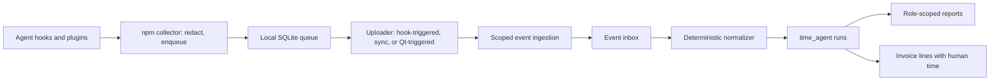

# Agent time tracking implementation plan

Status: confirmed implementation specification, revised after a design review on 12 October 2026. Vendor research checked 12 October 2026. Repository baseline: `dev` at `1fceeaad`. This revision replaces the earlier proposal (written against `7d559faf` on `feat/0-google-login`), which kept agent time non-billable and out of invoices.

Work Address tracks the time AI agents spend working on a project, separately from human time, and bills it. A worker keeps a list of agents, one per product, attaches them to projects they work on and sets a rate for each. The worker's invoice carries a line for their own hours and a line for each agent. Use deterministic lifecycle signals from the agent's own hooks; expose incomplete coverage where they are not available. Do not make the language model responsible for starting or stopping a timer.

In this plan, **worker** means whoever runs the agents: a project worker, or the project owner tracking their own agents.

This plan covers Claude Code, Codex, Claude Cowork, current Kimi Code, legacy Kimi CLI, OpenClaw, NousResearch Hermes Agent, OpenCode and an extension path for other runtimes. "Hermes" means NousResearch Hermes Agent; consumer Kimi Agent/Work support is a separate capability from its coding tools. Vendor capabilities below are supported by opened primary documentation, but no adapter has been installed or run. All new APIs, fields, package names, limits and phases are proposed Work Address contracts, not existing functionality.

### Relation to earlier documents

- **`web/docs/research/metering-the-agent-hour.html` (r7, 28 Aug 2026).** Adopted: agent work is billable; an itemised invoice with human and agent lines; a rate per agent rather than one project rate; evidence frozen when an invoice is issued. Not adopted: an agent as its own `User` with a keypair and `operatorAddress` (agents are entries under the worker here), an `agentActivity` bag on `Time` (agent runs get their own table), and re-keying `time` to `(project, user, fromAt)` (not needed, since agent rows never enter `time`). Deferred: at-cost pass-through lines and third-party corroboration.
- **`web/docs/development-plan.md:163`** leaves "AI-agent metering" out of the first marketplace launch. This plan targets `dev` and does not depend on `feat/0-marketplace`.

## Product contract

- Preserve the current desktop tracker and its human activity records. Human `Time` rows, queries and behaviour are unchanged.
- A worker owns a list of agents, one per product (Claude Code, Codex, …). They attach agents to projects they work on and set each agent's hourly rate for that project, starting at $0.00.
- Agent time is billable. One invoice per worker per period carries a human line and one line per agent, each at its own rate.
- Never add human hours and agent hours into one figure. Money may be added: dashboards show human, agent and combined amounts.
- Only the worker adds, edits, removes or detaches their agents. The project owner sees every agent, rate, run and prompt on the project but cannot change them. The owner's protections are rejecting an invoice and removing the worker.
- Other workers see nothing of another worker's agents: not the agent, its time, its rate or its content. Viewers see nothing about agents.
- Capture the prompt, the final response, tokens, model, timings, outcome, tool names with counts and durations, commit SHAs and a count of changed files. Do not capture file paths, tool arguments or results, file contents, command output or model reasoning. Agents never trigger screenshots or input-activity capture.
- Agent records are produced by the worker's own collector. Detailed statistics are the evidence; no tamper-proof labour claim is made. The owner's remedy for a wrong invoice is rejection.
- A manual timer is a fallback where automatic tracking does not qualify. Manual time is billable and flagged `manual` on the invoice line.

## Decisions

| Area | Decision | Not chosen |
| --- | --- | --- |
| Purpose | Agent time is billable work | Observability only; parking the feature |
| Agent identity | An entry in the worker's agent list, one per product | Agent as its own `User` (memo); several agents per product |
| Storage | `time_agent` table in the Time domain, one row per run | A `kind` column on `time`, which forces a human filter into ~28 server and 6 web call sites |
| Attachment | A worker-managed agents list on Project, beside `workerAddresses` | Agents inside the owner-managed `workerAddresses` |
| Rate | Set by the worker per project from $0.00; the rate when the invoice is created applies | Owner-set rates; acknowledgement gates; rate history |
| Invoice | One per worker per period: human line plus one line per agent, frozen snapshot | One invoice per agent; a separate agent-only invoice |
| Rejection | New `REJECTED` state on every invoice, whole invoice only, releases its rows; ships first as its own change | Line-level rejection; agent-only rejection |
| Billed time | Union of working intervals within a task, summed across tasks; known human waits excluded; unclassified and manual time billed and flagged | Elapsed time; unions across independent tasks |
| Invoicing runs | Only finished runs; invoiced rows freeze; late corrections are quarantined | Updating invoiced rows; waiting out the correction window |
| Nested agents | The outer run is the task; inner runs are its children, billed once at the outer agent's rate | Inner product's rate; per-pairing choice |
| Removal | Worker detaches an agent: past hours stay invoiceable at its last rate. Owner removes the worker: agent hours follow the worker's existing rule and cannot be invoiced | Agents keeping billing rights their worker lost |
| Visibility | Owner: everything. Worker: own agents only. Viewer: nothing | SPEC's project-wide time visibility for agents |
| Content | Prompt, response, tokens, model, timings, outcome, tool names/counts/durations, commit SHAs, changed-file count | Paths, tool arguments/results, reasoning |
| Text hygiene | Secret scan in the collector and on the server; 16 KB cap per text field; text dropped on scanner failure | Storing raw text |
| Products | All named products, each behind its own flag as it qualifies; Cowork through plugin hooks only | One release for all; organisation-level Cowork OTel |
| Tokens and response | Read from the transcript at Stop, pinned to qualified versions; null otherwise | OTel receiver; hook payloads only |
| Measurement | Full model computed on the server from an event inbox | Run assembly in the collector |
| Collector | npm package and agent-native plugins; pip shim for Hermes (needs Node) | Standalone binaries; Homebrew; hosting in the Qt app |
| Background upload | No resident service: hook-triggered uploader with a queue lease, sync flush at Stop in cloud/CI, `sync` command, Qt app may trigger `sync` | OS login services; a Qt-hosted daemon |
| Credentials | Per machine, write-only, scoped to the worker's agents and projects, 90 days | The worker's JWT; the memo's agent keypair |
| Baseline | `dev`, using the repository's `schema:sync` | `feat/0-marketplace`; new migration tooling |

## Integration findings

"Documented" means a primary source describes the surface. "Qualified" must mean our conformance tests pass on a recorded product version and deployment. None of these adapters is qualified yet.

| Product and surface | Documented capture route | Implementation choice | Qualification boundary |
| --- | --- | --- | --- |
| Codex local CLI and desktop runtime | Lifecycle hooks; app-server notifications; noninteractive JSONL; OTel | Native hooks; app-server or JSONL for runs our integrator launches | Pin surface/version and prove continuations, interruption, wait coverage and hook trust |
| Claude Code | Hooks and optional OTel traces/metrics | Native hook adapter; tokens and final response from the transcript at Stop | Stop hooks alone miss interruption and may allow continuation |
| Claude Cowork | Plugin hooks; Team/Enterprise OTel; cloud and legacy local execution | Plugin hooks only, shipped in the Claude Code plugin | Lifecycle coverage and authenticated cloud egress must pass; otherwise the manual timer |
| Current Kimi Code | Hooks and experimental Server API | Hooks first; Server API for qualified richer observation | Current codebase, installed schemas and cross-process visibility |
| Legacy Kimi CLI | Wire JSON-RPC transport | Optional separate adapter for explicitly launched legacy sessions | Archived codebase; separate compatibility package |
| OpenClaw | Typed plugin observers, diagnostic events, OTLP | Passive plugin/diagnostic adapter | Session attribution, nested-harness correlation, incomplete wait visibility |
| Hermes Agent | Python observer hooks | Passive observer plugin via a pip shim that hands events to the npm collector | Per-turn end semantics, delayed child callbacks, version-pinned observer contract |
| OpenCode | JS/TS plugin lifecycle events | Native plugin after the named products | Verify start/status, permissions and terminal payloads |
| Other agents and frameworks | Explicit SDK callbacks or qualified OTel spans | Public emitter SDK and adapter interface | No claim that arbitrary MCP/OTel support provides full run lifecycle |

### Codex

The hook reference documents `UserPromptSubmit`, `Stop`, `Interrupt`, `SessionStart/End`, `SubagentStart/Stop`, tool hooks and `PermissionRequest`. Turn hooks expose `turn_id`; common input has `session_id`; subagent hooks use the parent session ID plus `agent_id`. `SessionEnd` is not a turn boundary. Stop hooks can cause continuation. Non-managed hooks need trust review, and plugin hooks are skipped until the user trusts them. Use a short, silent local enqueue handler; validate event-specific success output, including JSON for Stop. Transcript formats are explicitly unstable: read only the token usage and final message at Stop, pinned to a qualified version, and store null for any other version. [Codex hooks](https://learn.chatgpt.com/docs/hooks)

App-server exposes `turn/started`, `turn/completed`, item notifications, approval requests and `serverRequest/resolved`. Terminal turn status distinguishes completed, interrupted and failed. Generate schemas from the installed binary. This is a client protocol, not proof that an independent observer can attach to every existing desktop session. Prefer it when our integrator owns the connection. [App-server](https://learn.chatgpt.com/docs/app-server)

`codex exec --json` emits `thread.started`, `turn.started`, `turn.completed`, `turn.failed` and item events. A wrapper must create a durable local run ID where the stream lacks one. It measures only its launched execution. [Noninteractive mode](https://learn.chatgpt.com/docs/non-interactive-mode)

OTel can enrich API/tool timings, but logs may contain tool-output snippets even when prompt logging is disabled. Sanitize before storage. Hook-bearing plugins currently require manual distribution rather than public directory submission. [Telemetry](https://learn.chatgpt.com/docs/config-file/config-advanced), [plugin distribution](https://developers.openai.com/plugins/deploy/submission)

### Claude Code

Hooks provide `UserPromptSubmit` (with the prompt text), `Stop`, `StopFailure`, `SessionEnd`, tool lifecycle, `PermissionRequest`, subagent lifecycle and MCP elicitation events. Correlate `session_id`, `prompt_id`, `agent_id` and tool IDs when present. `Stop` does not fire on user interruption and another hook may continue execution. Collector timestamps are needed when producer timestamps are absent. Hooks carry no token counts: read usage and the final assistant message from the transcript at Stop, pinned to qualified versions. Cloud settings and local settings are separate deployment concerns. [Hook contract](https://code.claude.com/docs/en/hooks)

OTel's `claude_code.active_time.total` distinguishes `type=user` and `type=cli`; do not ingest their sum as agent time or import its user dimension as human time. Optional beta traces distinguish interaction, tool execution and time blocked on a user. `PermissionRequest` alone does not prove a human waited: another hook may resolve it. Require correlated blocking/resolution evidence. Trace enrichment must not duplicate hook records. [Monitoring](https://code.claude.com/docs/en/monitoring-usage)

### Claude Cowork

Current help supports plugin hooks in Cowork as well as Claude Code, without establishing identical hook schemas. Cowork is cloud-default with legacy local execution; cloud tasks generally cannot reach private addresses, so the hook must upload over authenticated HTTPS with a credential issued for that sandbox. Ship Cowork support inside the Claude Code plugin and qualify it in its actual execution environment. [Plugin support](https://support.claude.com/en/articles/13837440-use-plugins-in-claude), [architecture](https://support.claude.com/en/articles/14479288-claude-cowork-architecture-overview)

Organisation-level Cowork OTel is out of scope. It is configured by a Team/Enterprise admin, who is usually the client rather than the worker, so it does not map onto per-worker credentials or agents. Revisit only if a client asks to send it. [OTel setup](https://support.claude.com/en/articles/14477985-monitor-claude-cowork-activity-with-opentelemetry)

If plugin-hook collection fails qualification, Cowork uses the manual timer, billed and flagged `manual`, with a visible integration status. Do not advertise automatic Cowork run timing until that gate passes.

### Kimi Code and legacy Kimi CLI

The legacy `MoonshotAI/kimi-cli` repository directs users to `MoonshotAI/kimi-code`. Use separate product IDs. [Legacy repository](https://github.com/MoonshotAI/kimi-cli), [current repository](https://github.com/MoonshotAI/kimi-code)

Current Kimi Code hooks include `TurnStarted`, `Stop`, `StopFailure`, `Interrupt`, `PermissionRequest/PermissionResult`, subagent events and an optional `SessionHeartbeat`. Prefer `TurnStarted` so scheduled/system turns are covered. Heartbeats prove liveness, not execution. `Interrupt` covers user interruption, not timeouts or programmatic abort; `SubagentStop` documents successful completion. Failed children require another qualified signal or remain unknown. Stop continuation requires fixtures. The default hook timeout is 30 seconds. [Current hook contract](https://moonshotai.github.io/kimi-code/en/customization/hooks)

The experimental Server API documents `/api/v1/meta`, `/api/v1/ws`, timestamps, session identity, turn/approval/question/subagent events and durable replay using `{seq,epoch}`. Volatile events are not replayable. Recovery beyond the documented 1,000-event buffer needs a snapshot and resubscription. Use the installed `/openapi.json` and `/asyncapi.json`; some reads can resume a cold session, and cross-process observation is not necessarily immediate. Do not start or resume work just to track it. [Server API](https://www.kimi.com/en/help/kimi-code/cli-server-api)

Legacy Wire uses `TurnBegin`, `TurnEnd`, interruptions and nested subagent events. Negotiate its protocol; do not reuse current Kimi mappings. Neither coding integration establishes support for the consumer Kimi app. [Legacy Wire](https://moonshotai.github.io/kimi-cli/en/customization/wire-mode.html)

### OpenClaw

Use typed plugin observers and diagnostic subscriptions, rather than treating `HOOK.md` automation hooks as equivalent. Session hooks describe session lifetime; `agent_end` and run diagnostics are more appropriate run signals. Child hooks use different field names for the child identity at spawn and end. Observer enqueue work must remain bounded. [Hook reference](https://docs.openclaw.ai/plugins/hooks/reference)

Diagnostics include `harness.run.started/completed/error`; spans include `openclaw.run`, `openclaw.harness.run`, model and tool execution. Some progress signals are direct-only. Default exported telemetry omits session keys, so OTLP alone does not guarantee project attribution. [Spans and events](https://docs.openclaw.ai/gateway/opentelemetry/spans-and-events), [telemetry privacy](https://docs.openclaw.ai/gateway/opentelemetry/privacy-and-trace-context)

Use available run identity and input provenance; a trigger labelled `user` need not be an external human. Model-call telemetry is not uniform across embedded and external harnesses. Universal passive human-wait boundaries are not established. Do not request approval-control privileges merely to measure time. [Prompt and session hooks](https://docs.openclaw.ai/plugins/hooks/prompt-and-session)

An OpenClaw run invoking Codex or Claude Code is observed by both adapters. See [Nested agents](#nested-agents): the OpenClaw run is the task and is billed once. Never deduplicate using timestamps alone.

### Hermes Agent

The observer contract `hermes.observer.v1` supplies session/turn IDs, `pre_llm_call`, `on_session_end`, tool/API events, subagent events and `on_human_input_request/resolved` with request identity. Human-input events do not establish universal turn/tool correlation: prove the owning run and blocking scope before claiming complete wait coverage. Prefer callbacks returning `None`, accepting future keyword arguments and failing open. [Observer contract](https://github.com/NousResearch/hermes-agent/blob/main/website/docs/developer-guide/observer-hooks.md)

Despite its name, `on_session_end` runs at the end of each conversation turn, including failure/interruption. Pair it with `pre_llm_call`, not the new-conversation `on_session_start`. Start occurs after context compression, so coverage is observed turn runtime rather than full request latency. Child stop callbacks can arrive after child futures drain. Native duration must have a source start/end anchor to join a wall-time union; do not anchor it at callback receipt. Plugins require explicit enablement. [Hook semantics](https://github.com/NousResearch/hermes-agent/blob/main/website/docs/user-guide/features/hooks.md), [plugins](https://github.com/NousResearch/hermes-agent/blob/main/website/docs/user-guide/features/plugins.md)

### Other systems

OpenCode documents `session.status`, `session.idle`, `session.error`, permission and tool events, with project/worktree context. It is the next native plugin, subject to payload and replay qualification. [OpenCode plugins](https://opencode.ai/docs/plugins/)

For custom frameworks, expose our versioned event emitter SDK. OTel is an optional input transport: normalize verified agent spans and preserve trace/span IDs. GenAI agent semantic conventions are still marked Development; pin their schema and distinguish agent spans from nested model/tool spans. Never sum every span in a trace. [OpenTelemetry agent conventions](https://github.com/open-telemetry/semantic-conventions-genai/blob/main/docs/gen-ai/gen-ai-agent-spans.md)

### Hook process lifetime

These facts decide how uploads run (see [Collector](#collector)). Phase 0 must confirm each on real installs.

- **Claude Code:** default command timeout 600 s; `SessionEnd` hooks share a 1.5 s budget. Hook commands run unsandboxed, each in its own session on macOS and Linux. In `-p` mode async hooks are killed at teardown, and the docs advise starting a fully detached process. Windows child-process handling is undocumented. [Hooks](https://code.claude.com/docs/en/hooks)
- **Codex:** default timeout 600 s; `SessionEnd` 1 s (max 3 s); at most 8 async hooks per session, cancelled at session end. On Unix a timeout kills the hook's process group. On Windows the hook runs in a kill-on-close Job Object: descendants are preserved on success and terminated on timeout. Node's `detached` does not break away from a Job Object.
- **Kimi Code:** default timeout 30 s; hooks run in their own process group and are signalled, then killed, on timeout; hooks fail open.
- **Linux:** `setsid` does not leave the systemd session scope, so a detached uploader dies at logout when `KillUserProcesses=yes`.
- **Cloud:** Claude Code cloud VMs are reclaimed after inactivity, and network access defaults to an allowlist. The Work Address API domain must be reachable from the sandbox.

## Measurement rules

A **session** is a persistent conversation. A **run** is one execution turn, from a prompt (or a system/scheduled trigger) to its stop, including its internal model/tool loop. A **child run** is a separately identified subagent execution, or a run of another agent product launched by this one. A **task** is a root run with all of its descendants. Resuming a chat does not join the idle gap into either run.

| Measure | Definition | Display rule |
| --- | --- | --- |
| Human tracked time | Existing Time records and activity semantics | Unchanged; never inferred from agent messages |
| Agent elapsed time | Union of observed run envelope intervals in the selected grouping, including waits within them | Label elapsed; incomplete boundaries produce bounded/partial results |
| Agent runtime | Union of execution intervals with complete external-wait classification | Available only for qualified coverage; otherwise null, not zero |
| Known human-wait time | Union of explicitly paired approval/input waits per run | Partial coverage must be labelled; one blocked tool does not pause independent work |
| **Billed agent time** | Per task: union of intervals in state `running` or `unknown` across all runs in the task. Per agent line: sum over tasks, plus manual time | The invoice line shows the total, the unclassified part and the manual part |
| Summed agent runtime | Sum of per-agent-instance runtime unions | Can exceed wall time; a detail, not a total |
| Observed API/tool activity | Union of timestamped API/tool spans from a partial source | Counts as `running` intervals for billing; gaps between spans are never billed |

**Billing rules.** Known human waits are excluded only where no run in the task is `running` or `unknown` at that moment: an approval blocking the parent does not pause a child that keeps working. The unclassified part is the portion of billed time covered only by `unknown` intervals. Manual entries are billed as recorded and flagged `manual`. A run belongs to the invoice period and retention window that contain its `fromAt`, whole, the same rule human rows use. Only finished runs are invoiceable: terminal or stale, and past the 60-second grace period.

All calculations use integer milliseconds and half-open intervals `[start,end)`. Store UTC; use the selected reporting timezone only for bucketing. Clip intervals to the requested period before unioning in reports. Do not round each event to minutes; invoice lines round once, per line. Native duration and monotonic collector time take precedence over callback-arrival differences when they can be tied to the same clock domain. Preserve precision/clock provenance; reject impossible negative intervals.

Model inference, tool execution, network latency and retries are working time. Queue time before execution, explicit waiting for a person, idle time between turns and unobserved gaps are not. An internal wait for a child stays inside the parent's envelope, but billing counts the task's union, so it is never counted twice. CPU time and cost are outside this metric; tokens are recorded as statistics, not billed.

**Concurrency example.** Agent tasks A (10:00–10:10) and B (10:05–10:15) are independent and fully classified. Billed agent time is 20 minutes, like two contractors; the agent wall time shown as a detail is 15 minutes. If the human tracker reports 12 minutes, the invoice shows a human line of 12 minutes and an agent line of 20 minutes. Never report 32 minutes of hours.

**Task example.** A root run 10:00–10:20 starts a subagent 10:05–10:15. Billed time is 20 minutes, not 30. The same holds when the child is a Codex run launched by OpenClaw.

**Coverage example.** A ten-minute run has a known two-minute approval wait. A complete adapter bills 8 minutes, none unclassified. An adapter that cannot classify the rest bills 8 minutes with 8 minutes unclassified, reports 10 minutes elapsed and leaves runtime null. No silent estimate fills the missing classification.

A duration without a trustworthy anchor can support a separately labelled duration sum but cannot join wall-time unions or billing; retain it as technical evidence only.

## Fit with the existing application

Paths are relative to the repository root. [SPEC.md](../SPEC.md) defines five domains. Agent runs live in the Time domain in their own table; agents and their attachments live on User and Project; invoice lines live on Invoice; per-run tool usage lives in Statistics ([app-statistics.md](app-statistics.md)). No new domain, no synthetic agent `User`.

| Existing path | Current behaviour | Change |
| --- | --- | --- |
| `api/src/entity/time.ts`, `time-repository.ts`, `time-manager.ts` | Human slices; unique `(project, fromAt)`; totals, search, upsert, purge | **Unchanged.** Agent rows never enter `time`, so no human query needs a filter |
| `api/src/entity/invoice.ts`, `model/invoice.ts` | States `Requested` and `PAID`; `amountCents`; no line items | Add `REJECTED`, `rejectedAt`, `rejectionReason`, `lines` snapshot |
| `api/src/service/invoice-manager.ts` | `create`, `createFromTimeIds`, `ensureForProject` select the issuer's unpaid `time`; `amountFor` prices `minutesActive × rateHour`; `assertCanInvoice` requires a current worker or owner | Also select the issuer's finished, uninvoiced `time_agent` runs; price one line per agent; cascade paid/unpaid to both tables; add owner rejection. `assertCanInvoice` unchanged, so a removed worker cannot invoice agent lines either |
| `api/src/entity/project.ts` | `workerAddresses`/`viewerAddresses` are owner-managed `text[]`; `rateHour` is `decimal(6,2)` | Add a worker-managed `agents` attachment list |
| `api/src/entity/user.ts` | Identity; `rate` is `decimal(6,2)` | Add the worker's `agents` list |
| `api/src/middleware/payload-logger.ts` | Logs every request body | Exempt `/api/agent-tracking/events` |
| `api/src/app/app.ts` | Global 30 MB JSON parser | Enforce ingestion limits before the global parser |
| `api/src/service/auth/authenticator-time-tracker.ts` | Pairing hands the desktop app an unscoped user JWT | Not reused for the collector. The Qt app may use its JWT once to request a scoped credential |
| `api/src/service/project-statistics-manager.ts` | Lazily cached process totals per period | Replaced by the Statistics domain ([app-statistics.md](app-statistics.md)); agent statistics are role-scoped queries over `time_agent` and `agent_tool_usage` |
| `web/src/features/dashboard/ui/dashboard-summary/` | Totals and unpaid amounts across projects | Money as human, agent and combined lines; hours never combined |
| `web/src/features/time/model/time-grid.ts` | Human activity percentages and daily sums | Unchanged; agents get their own view |
| `api/dockerfile.prod`, `dockerfile.dev`, `docker-compose-dev.yml`, `scripts/installer.sh` | Schema applied by `schema:sync` on every start | Unchanged. Every schema change here is additive |

Preexisting issues this plan does not change: collaborator premium gating on `dev` versus SPEC's "collaborators are free" (agents ride on the worker's membership, so the gate never applies to them); a removed worker losing the right to invoice past hours (agents follow the same rule); the desktop pairing token being retrievable until its nonce expires.

## Architecture



Use the current API and PostgreSQL deployment. Start with a PostgreSQL event inbox and worker lease; no Kafka or new service. Redis may wake workers but is not the queue or clock.

## Data model

### Agents and attachments

`User.agents` (jsonb, owned by that user):

| Field | Rule |
| --- | --- |
| `id` | UUID, stable |
| `name` | Worker-chosen label, ≤ 60 characters, plain text |
| `product` | Registry ID: `claude-code`, `codex`, `claude-cowork`, `kimi-code`, `kimi-cli`, `openclaw`, `hermes`, `opencode`, or a registered SDK product |
| `createdAt`, `removedAt` | `removedAt` set instead of deleting, so invoice lines and runs keep a name |

At most one active agent per product per worker. Runs are assigned to an agent by product.

`Project.agents` (jsonb list, beside `workerAddresses`):

| Field | Rule |
| --- | --- |
| `agentId`, `workerId` | The attached agent and the worker who owns it |
| `rateHourCents` | Integer cents per hour, ≥ 0, default 0 |
| `attachedAt`, `detachedAt` | Detaching keeps the entry so past runs stay invoiceable at this rate |

Only the owning worker writes their entries, and only while they are a worker or the owner of the project. The project owner reads every entry. Other workers and viewers never receive other workers' entries. Owner project edits must not be able to overwrite this list. When the owner removes a worker from `workerAddresses`, the entries stay for the record; the worker can no longer invoice, so neither can their agents.

### `time_agent`

One row per run. Subagents and nested product runs are their own rows linked to their parent.

| Field | Rule |
| --- | --- |
| `id`, `createdAt`, `updatedAt`, `deletedAt` | From the abstract base entity |
| `userId`, `projectId` | The worker and the project; project validated server-side and immutable for the run |
| `agentId` | The worker's agent for this product |
| `product`, `surface` | Registry IDs, e.g. `codex` + `cli`, `desktop` or `cloud` |
| `sourceInstanceId` | The collector install, stable across credential rotation |
| `sourceSessionId`, `sourceRunId`, `sourceAgentId` | Opaque source identities; the run ID may be collector-generated with `identityOrigin=collector` |
| `parentRunId`, `taskRootId`, `executionKey` | Lineage; `taskRootId` groups a task for billing |
| `fromAt`, `toAt` | Envelope from observed start to terminal or last defensible evidence; never extended on read |
| `status` | `running`, `waiting`, `completed`, `failed`, `cancelled`, `unknown`; failure reason is an allowlisted code |
| `segments` | Ordered nonoverlapping `{fromAt,toAt,state,evidence}` within the envelope; `state` is `running`, `human_wait` or `unknown` |
| `measurement` | Versioned: `coverage=run\|activity_only\|manual`, wait coverage, time basis, boundary quality, provisional flag, adapter/runtime/schema versions, normalizer revision |
| `prompt`, `response` | Redacted text, each ≤ 16 KB, with `promptLength`/`responseLength` and SHA-256 hashes of the redacted originals; `textStatus=ok\|truncated\|dropped` |
| `tokens` | `{input, output, cacheRead, cacheWrite}`, nullable when the source version is not qualified |
| `model` | Model identifier as reported |
| Tool usage | Not a column: one `agent_tool_usage` row per run and tool in the Statistics domain, `{tool, count, durationMs}`, tool names only. Durations may overlap and are never summed into time |
| `commits`, `filesChanged` | Commit SHAs (≤ 50) and a count of changed files |
| `manual` | True for manual-timer entries |
| `isPaid`, `invoiceId` | Same meaning as on `time`; owned by Invoice |
| `sourceRefs` | Minimal event/cursor references for diagnostics; no paths or bodies |

The canonical run key is `(userId, product, sourceInstanceId, sourceSessionId, sourceRunId, sourceAgentId)`, unique, with a non-null root agent identity and a stable synthetic session namespace where the source has none. If native run IDs reset within a session, namespace them with the producer epoch. Source IDs need bounded length, stable encoding and case-sensitive comparison. Index `(projectId, fromAt)`, `(userId, fromAt)`, `invoiceId`, `taskRootId` and the run key. Validate segment order, nonnegative length and containment in application code; coalesce adjacent segments with identical state/evidence. Limit 10,000 segments per run; above it mark coverage incomplete and surface an error rather than truncating silently.

A row with `invoiceId` set is frozen: the normalizer never rewrites it. Rejection clears `invoiceId` and unfreezes it.

### Invoice

| Field | Rule |
| --- | --- |
| `state` | `Requested`, `PAID`, `REJECTED` |
| `rejectedAt`, `rejectionReason` | Set by the owner; reason optional, ≤ 500 characters, plain text |
| `lines` | Frozen snapshot: `[{kind: human\|agent, agentId?, name, product?, minutes, unclassifiedMinutes?, manualMinutes?, rateHourCents, amountCents}]` |
| `amountCents` | Sum of line amounts; each line rounded once |

Existing invoices have `lines = null` and render as one human line. Only the issuer marks an invoice paid; only the owner rejects; only a `Requested` invoice can be rejected. Rejection clears `invoiceId` and `isPaid` on its `time` and `time_agent` rows, keeps the invoice as a record, and lets the issuer issue a new one.

### Technical persistence

Infrastructure records, not hour or money ledgers:

- `AgentCredential`: hashed secret with lookup prefix, owning worker, machine label, source instance, scope (`events:write`), expiry (90 days), revocation and last use. Allowed agents are the worker's agents; allowed projects are those where the worker is currently a worker or the owner.
- `AgentEvent`: immutable envelope including redacted content, server receipt time, payload hash, processing status and retry/error code.
- `AgentSourceCursor`: source epoch/cursor, worker lease and last contiguous committed watermark. Never advance past an unprocessed event belonging to another run.

The `time_agent` row is the normalizer's checkpoint. Keep a run's events until the run is final, any quarantine is resolved and the events are older than the seven-day correction horizon; then delete them. The inbox is the only place raw event content lives, so this horizon is also its privacy window.

## Event contract

A versioned Work Address schema shared by collector, server and fixtures. Strictly reject unknown payload fields at the public boundary. Provider adapters transform and redact input locally before enqueue.

```json
{
  "schemaVersion": 1,
  "eventId": "2b9f4e38-5a8f-4455-81cc-15ff91f5c88b",
  "source": {
    "product": "codex",
    "surface": "cli",
    "instanceId": "collector-registered-id",
    "adapterVersion": "0.1.0",
    "runtimeVersion": "qualified-version",
    "epoch": "process-boot-id",
    "sequence": 42
  },
  "projectId": "7f82d6f0-87d6-4e50-a55c-02be7ce7b240",
  "sessionId": "opaque-session-id",
  "runId": "opaque-turn-id",
  "agentId": "root",
  "eventType": "run.started",
  "occurredAt": "2026-10-12T09:00:00.000Z",
  "observedAt": "2026-10-12T09:00:00.004Z",
  "clock": {
    "basis": "collector_monotonic",
    "bootId": "process-boot-id",
    "monotonicMs": 185004
  },
  "capabilities": {
    "runBoundaries": true,
    "externalWaits": "partial",
    "replay": false
  }
}
```

The sample is our envelope, not a vendor payload. `agentId` here is the source's agent identity within the run (`root` or a subagent ID), not the worker's agent list entry; the server resolves that from `source.product`. `occurredAt` uses source time when trustworthy, otherwise collection time with the correct basis. The server sets `receivedAt`; clients cannot supply user identity, rates or billing fields. Register capabilities against a qualified adapter version; clients cannot upgrade their own quality classification.

Normalized types are `run.started`, `run.completed`, `run.failed`, `run.cancelled`, `wait.started`, `wait.ended`, `run.observed`, `activity.observed`, `run.content` and `manual.entry`, as a discriminated union with conditional required fields:

| Event data | Required contract |
| --- | --- |
| Run observation | `observedState=running\|human_wait\|unknown`, `evidenceKind=runtime_state\|lifecycle\|native_span`; `human_wait` references known blocking request IDs |
| Wait events | `requestId`, `waitScope={kind:run\|tool\|child,scopeId}`, optional proven `toolCallId`/`childSourceKey`; resolution outcome may be `unknown` |
| Native timing | Optional `sourceDurationMs`, `durationBasis=source_monotonic\|source_wall`, optional `sourceStartedAt`/`sourceEndedAt`; source clock identity required |
| Observed activity | `activityKind=model\|tool`, `activityId`, anchored `sourceStartedAt`/`sourceEndedAt` |
| Run content | `prompt`, `response` (redacted, ≤ 16 KB each, with original lengths and hashes, `textStatus`), `tokens`, `model`, `tools` (written as `agent_tool_usage` rows), `commits`, `filesChanged`; every field optional |
| Manual entry | `fromAt`, `toAt`, optional note; always `coverage=manual` |
| Provenance | Optional `parentSourceKey`, `executionKey`, `sourceCursor`, `outcome`; each with a bounded schema |

Adapters normalize vendor duration units to milliseconds. Duration-only evidence is not `activity.observed` and cannot place intervals. An activity-only projection uses a deterministic synthetic run key when no native run correlation exists; later proven run evidence enriches or transactionally aliases it.

`waitScope` identifies the whole run or a tool/child. The normalizer pauses the whole run only with evidence that no independent work continues. Multiple outstanding run-blocking waits form a set keyed by request ID: the first opens a waiting interval and the last resolved request closes it. A cleared request is not automatically permission granted. A proven terminal boundary closes unresolved waits.

`run.observed` means the adapter positively observed this run's current execution state. Collector, process and session heartbeats are health signals, not this event. Model-emitted timer calls produce `manual.entry` and cannot claim native observation.

Generate `eventId` before a durable enqueue and reuse it for retries. For replayable native streams, derive stable identity from source namespace, epoch and native event ID/sequence. For hooks without an event ID, use source invocation identity where available; otherwise assign a UUID once and deduplicate downstream transitions by run/request identity.

## Normalization and failure recovery

Implement `AgentTimeNormalizer` as a deterministic class with an injectable clock and fixture-driven tests. Order by native source sequence within a proven stream/epoch; otherwise use source time, causal identities and collector ordering. Never impose one global sequence across concurrent processes.

1. Validate identity, credential, project access, agent attachment, bounds, schema and payload hash; persist the event transactionally before acknowledging acceptance.
2. Serialize normalization by canonical run key using PostgreSQL locks/leases. A worker crash must leave durable unprocessed events claimable by another worker.
3. On a start, create/upsert the `time_agent` row. If wait coverage is complete, open running state; otherwise classify unproven spans as unknown while preserving the elapsed envelope.
4. Apply explicit wait/resume/observation/content events and terminal outcomes. Stop-hook attempts are adapter candidates until continuation semantics are reconciled; "Stop hook called" is not final completion.
5. Commit the row revision and processed-event cursor together. Replay of any acknowledged event must produce the same result.
6. Mark unsupported, missing or contradictory evidence as partial/unknown and surface a diagnostic. An error notification alone is not always terminal because runtimes retry.
7. If the run's row is invoiced, do not change it. Quarantine the event with `RUN_INVOICED` and show it to the worker. If it matters, the owner rejects the invoice and the worker reissues it.

Publish provisional rows immediately; use a 60-second grace period for routine reordering and finalization. Accept events up to seven days old; reject older ones with `REVISION_WINDOW_EXPIRED`. A terminal before its start remains pending, never a guessed duration. Conflicting terminals are quarantined unless the adapter defines an authoritative correction rule.

Liveness for capable adapters: observe every 15 seconds and mark a run stale after 90 seconds without evidence. Staleness closes counting at the last proven timestamp, not at the timeout. Sparse hook adapters may later reconcile a valid start/end envelope but cannot claim wait coverage that was never observed. UI may show "running, last observed 2 minutes ago"; it must not persist a growing duration.

On suspend, reboot, disconnect or runtime crash, keep the open row as unknown/provisional and stop extrapolation. A restarted collector uses a new clock epoch; monotonic values are never compared across boots. Detect large wall-clock reversals and future timestamps (tolerance five minutes, configurable); quarantine rather than silently correcting them.

For a missing stop, do not invent success. A stopped child does not stop its parent, and a stopped parent does not prove all children stopped. Continued autonomous work needs its own documented continuation/start signal.

### Nested agents

When one agent product launches another (OpenClaw driving Codex or Claude Code), the outer run is the task and the inner product's runs are its children. The task is billed once, at the outer agent's rate, under the union rule. Persist the link through a validated `executionKey`, not an arbitrary client claim. When the adapters cannot correlate the two, setup asks the worker to choose which product records that work in that folder and suppresses the other. Never guess duplicates from similar times.

## API and authentication

All routes include the `/api` prefix and are new contracts.

| Route | Auth and behaviour |
| --- | --- |
| `GET/POST/PUT/DELETE /api/agents` | Signed-in user; their own agent list. `DELETE` sets `removedAt` |
| `PUT /api/project/:id/agents/:agentId` | The agent's worker, while a worker or the owner of the project; attach or set `rateHourCents` |
| `DELETE /api/project/:id/agents/:agentId` | The agent's worker; sets `detachedAt` |
| `POST /api/agent-tracking/credentials` | Signed-in user; issues a per-machine write-only secret, shown once. The Qt app may call this with its existing sign-in |
| `GET /api/agent-tracking/credentials`, `DELETE …/:id` | Own credential metadata (never the secret); revocation is immediate |
| `POST /api/agent-tracking/events` | Collector credential only; event batch; cannot authenticate to any other route |
| `POST /api/agent-tracking/search`, `/summary` | Signed-in user; runs and metrics scoped by role |
| `GET /api/agent-tracking/status` | Own collector health, queue/rejection summaries, held runs, qualification status |
| `POST /api/invoice/:id/reject` | Project owner; `Requested` invoices only; optional reason |

**Visibility, enforced on every agent read route and on project and invoice reads:** the owner receives all agents, attachments, runs, content and agent invoice lines on the project. A worker receives only their own. A viewer receives none. Project-wide agent totals are owner-only. Invoice visibility is unchanged from SPEC: a worker sees their own invoices, the owner sees all, a viewer sees none.

Use random 256-bit opaque secrets; store a secure hash plus lookup prefix; redact Authorization in logs. Credentials expire after 90 days with renewal and overlap for rotation. Local secrets belong in the OS credential store or a permission-restricted file, never in a hook file. A cloud sandbox receives its own credential through its supported secret mechanism. Never pass Work Address JWTs through prompts. Revoked credentials, removed membership and detached agents invalidate queued writes for the affected scope.

The ingest body is `{events: AgentEventV1[], health?: CollectorHealthV1}`. Health carries only nonnegative queue/rejection/loss counts, held-run counts and the last successful upload time; it never creates or extends a run. Rate-limit health-only requests to one per 30 seconds.

Limits: 100 events per batch, 1 MiB uncompressed body, 64 KiB per normalized event, 300 events/minute per credential with a 600-event burst. Make them configurable. Enforce them before decode and before the global JSON parser.

Each event gets a result:

```json
{
  "results": [
    { "eventId": "event-a", "status": "accepted" },
    { "eventId": "event-b", "status": "duplicate" },
    { "eventId": "event-c", "status": "rejected", "code": "AGENT_NOT_ATTACHED" }
  ]
}
```

`accepted` means durably stored, not yet visible. Reuse of an event ID with a different payload returns `EVENT_ID_CONFLICT`. An invalid envelope is HTTP 400; oversized 413; bad/expired credential 401; out-of-scope 403; throttled 429 with Retry-After. Retry network/429/5xx with exponential backoff and jitter; do not retry permanent failures. Keep rejected items in a bounded local diagnostic queue. The deduplication key is `(sourceInstanceId, eventId)` under the owning worker; cross-user collisions never reveal another user's event.

## Attribution, content and privacy

**Agent.** A run is assigned to the worker's active agent for its product.

**Project.** Precedence: explicit run override, explicit session mapping, an exact folder mapping the worker approved, then an opt-in machine default. Never select a project from prompt text, a model guess or a fuzzy repository-name match. Freeze the mapping when a run starts. Resolve Git worktrees to a stable local workspace identity, with user override. Keep paths and remote URLs local.

**Held runs.** A run with no project match, or whose agent is not attached to the matched project, stays in the local queue and is not uploaded. `status` and the Qt Agents page say what to do ("Attach Codex to project X"). Uploading makes prompts readable by the project owner, so the worker must have attached the agent first. Setup states plainly: "The project owner can read your agents' prompts and responses."

**Captured.** Prompt, final response, tokens, model, timings, outcome, tool names with counts and durations, commit SHAs, count of changed files.

**Never captured.** File paths, repository URLs, tool arguments and results, file contents, command output, environment variables, model reasoning, screenshots, input activity.

**Redaction.** The collector scans prompt and response for secrets (known key formats, private keys, high-entropy tokens, `.env`-style assignments) before enqueue, replaces matches with a marker and counts them. The server scans again before storing in the inbox. If the collector's scanner fails, enqueue the event with text dropped (`textStatus=dropped`), never raw. Cap each text field at 16 KB after redaction, keeping original length and hash.

**Logs.** Exempt `/api/agent-tracking/events` from `PayloadLogger`. Never attach ingestion bodies to error reports or traces.

**Local queue.** Cap at 100 MiB or seven days, whichever comes first. Never discard without incrementing a visible loss counter. Keep lifecycle events ahead of content and enrichment; once required events are lost, mark affected runs incomplete. Files are owner-only; use OS-backed encryption where the platform supports it.

**Retention.** `time_agent` follows the workspace's retention: on the hosted free plan, rows whose `fromAt` is older than 14 days are deleted, skipping rows linked to an invoice; self-hosted keeps everything. Run the purge when agent events are ingested, mirroring how human uploads trigger the human purge on `dev`. Prompts and responses go with their rows. Invoiced rows keep their content as the invoice's evidence. Project or user deletion removes runs, events and credentials; minimal hashed tombstones prevent replay resurrection within the correction horizon.

Scope is user-authorized tracking. A signed or authenticated event proves its source credential, not that the duration is true. Disabling tracking and revoking credentials must be straightforward; uninstall removes only the integration's own hooks.

## Collector

`@work-address/agent-tracker` is a Node/TypeScript package under `packages/agent-tracker`, with the shared schema in `packages/agent-tracking-contract`. There is no publishing precedent in this repository; add the build and release plumbing.

| Channel | Covers | Phase |
| --- | --- | --- |
| npm: `npx @work-address/agent-tracker setup` detects installed agents, writes hooks, sets folder mappings, stores the credential; also `status`, `sync`, `uninstall` | Every product | 4 |
| Claude Code plugin from a GitHub-hosted marketplace, hooks bundled | Claude Code and Cowork | 4 (Cowork 5) |
| Codex plugin, distributed manually | Codex | 4 |
| OpenClaw and OpenCode plugin packages | Those products | 5–6 |
| `pip install work-address-agent-tracker` shim | Hermes; requires the npm collector | 5 |

No standalone binaries, no Homebrew, no code signing.

**Hook path.** Hooks call `~/.work-address/bin/agent-tracker`, a shim that resolves Node on every run (recorded path, then the login shell, then common install locations) and reports in `status` when it cannot. A versioned Homebrew path such as `/opt/homebrew/Cellar/node@22/22.16.0/bin/node` disappears on upgrade, and GUI apps on macOS do not inherit the shell PATH.

**Capture.** A hook sanitizes, redacts and enqueues into a transactional SQLite queue within a short deadline (target p95 < 50 ms including Node start, hard cap 250 ms), then returns the product-specific success output. A tracking failure never blocks, approves, cancels or modifies the agent's work. Never write logs to a protocol's stdout.

**Upload.** No resident service and no OS login item.

- A SQLite lease lock ensures one uploader at a time.
- `SessionStart`, `Stop` and `SessionEnd` start a short-lived detached uploader that drains with backoff and exits.
- In cloud sandboxes and CI (`CLAUDE_CODE_REMOTE` or a CI variable set), `Stop` also flushes synchronously within its budget, because the VM may be reclaimed.
- `agent-tracker sync` uploads on demand. Anything left waits for the next session's hooks.

**Qt desktop tracker.** The app does not host the collector. It adds an **Agents** page that shows `agent-tracker status --json` (queue, rejections, held runs, credential expiry) and can trigger `sync`. It can request this machine's scoped credential using its existing sign-in. Agent features run whenever the app is open, independent of the human timer, and never take screenshots or record input. The app gains an opt-in "Start at login" setting on all three platforms. The agent service follows the app's current server and account.

## User experience

- **My agents** (account settings): the worker's agent list, one per product; add, rename, remove; credentials per machine with expiry and revocation; collector health per machine.
- **Project dialog, Agents tab:** the worker attaches or detaches their own agents and sets each rate. The owner sees every worker's agents read-only. Other workers see only their own. Viewers see no tab. The same tab carries the agent charts from [app-statistics.md](app-statistics.md): billed time per day by agent, tokens per day and the runs table. There is no project page; the dialog grows instead.
- **Agents view:** runs grouped by task, with filters for project, agent, product, date, status and coverage. Shows start/end, billed time with unclassified and manual parts, elapsed, runtime where qualified, known waits, child relationships, tokens, model, tool counts, commits, and the prompt and response for those allowed to read them. Missing runtime reads "Unavailable with this integration", never zero.
- **Invoices:** a human line and one line per agent with minutes, rate and amount; unclassified and manual minutes flagged. The owner has a **Reject** action with an optional reason; a rejected invoice shows its reason and the worker can issue a new one.
- **Dashboard and export:** separate human and agent sections; hours never combined; money as human, agent and combined amounts, scoped by role.
- **States:** empty, connecting, held runs waiting for attachment or project mapping, offline, credential revoked or expired, unsupported version, unqualified integration.

Use the repository's Effector/Farfetched data flow, Feature-Sliced Design, styled-components and shared UI components. No API calls from components.

## Implementation sequence and file plan

Each phase has a reviewable exit condition. Phase 0 runs alongside Phases 1–3, which use synthetic fixtures. Do not call an adapter supported because documentation exists.

| Phase | Work | Exit condition |
| --- | --- | --- |
| 0 | Sanitized lifecycle fixtures for every named product (version, OS/deployment, schema hash, wait/replay coverage, transcript token/response fields). Background-upload spike, below | Compatibility manifest marks each mode qualified, partial or unsupported; spike results recorded per OS |
| 1 | Invoice `REJECTED` state and owner rejection, for all invoices; a standalone change | Rejection releases rows; human invoice regression tests pass |
| 2 | Invoice `lines` snapshot; legacy rendering | Existing invoices, amounts and paid state unchanged |
| 3 | `User.agents`, `Project.agents`, credentials, `time_agent`, inbox, normalizer, ingestion and read APIs, agent invoice lines, synthetic adapter, retention, visibility | Replay, crash, ordering, retention, concurrency, tenant isolation and visibility tests pass; agent writes behind `AGENT_TRACKING_ENABLED` |
| 4 | npm collector, Claude Code and Codex adapters and plugins, setup and Agents UI, Qt Agents page | Real normal/interrupted/waiting/offline runs visible and invoiceable with truthful coverage; human totals unchanged |
| 5 | Kimi Code, OpenClaw, Hermes adapters; Cowork plugin hooks or the manual timer | Every named product has a tested mode or an explicit partial/unavailable status |
| 6 | OpenCode, generic emitter SDK, optional OTel, legacy Kimi adapter | Conformance harness reusable without changes to core accounting |

**Phase 0 background-upload spike**, on macOS, Windows and Linux, for Claude Code (CLI and desktop), Codex (CLI and desktop) and Kimi Code:

- A detached uploader outlives hook success, hook timeout and the agent exiting.
- Hook p95 stays under 50 ms including Node start.
- Windows: Codex's Job Object on success and timeout; Claude Code's handling of the hook process tree; no console window flash.
- Linux: `KillUserProcesses=yes` and `no`; SSH logout and tmux; WSL going idle; a container without systemd.
- Two uploaders racing for the lease; server deduplication when an upload is killed midway.

**Proposed additions:**

- `packages/agent-tracker/`: CLI (`setup`, `status`, `sync`, `uninstall`), product registry, local queue, redaction, credential storage, transport and adapters in `src/adapters/{claude-code,claude-cowork,codex,kimi-code,kimi-cli,openclaw,hermes,opencode}/`, with metadata fixtures next to their tests.
- `packages/agent-tracking-contract/`: versioned schema/types, canonical identity, product registry and adapter capabilities.
- `api/src/entity/time-agent.ts`, `agent-event.ts`, `agent-credential.ts`, `agent-source-cursor.ts` and their repositories.
- `api/src/controller/agent-controller.ts`, `agent-tracking-controller.ts`, `agent-tracking-credential-controller.ts`; `model/dto/agent.ts`, `agent-time.ts`; `service/agent-manager.ts`, `agent-time-manager.ts`, `agent-time-normalizer.ts`, `agent-event-worker.ts`; a dedicated collector auth service/decorator.
- Changes to `entity/invoice.ts`, `model/invoice.ts`, `service/invoice-manager.ts`, `controller/invoice-controller.ts`, `entity/project.ts`, `entity/user.ts`, project read/edit paths, `middleware/payload-logger.ts`, `app/app.ts`, `app/app-container.ts`, generated clients.
- `web/src/features/agent-tracking/` for My agents, the project dialog's Agents tab and the Agents view; invoice and dashboard changes in their existing slices. Agent charts use the shared chart components from [app-statistics.md](app-statistics.md).
- `api/src/entity/agent-tool-usage.ts` belongs to the Statistics domain and ships with this plan's Phase 3.
- `time-tracker/` (sibling repo): Agents page, `sync` trigger, credential request, opt-in start at login.

### Schema and rollout

All schema changes are additive (new tables, new nullable columns, a new state value), so they follow the repository's `schema:sync` on start. No migration tooling and no destructive change.

1. Ship invoice rejection (Phase 1), then invoice lines (Phase 2), each verified against human invoice fixtures.
2. Ship the agent schema and APIs with `AGENT_TRACKING_ENABLED` off; then enable the inbox/worker; then each qualified adapter behind its own flag.
3. Roll back by disabling the flags and stopping the worker. Keep data.

## Acceptance tests

| Scenario | Required result |
| --- | --- |
| Normal start, wait, resume, completion | Correct intervals, outcome and coverage; wait excluded only when proven |
| Duplicate batch and lost acknowledgement | Exactly one event and row effect; conflicting payload rejected |
| Two independent tasks overlapping | Billed time is the sum; wall time shown as a detail |
| Root run with subagent; OpenClaw driving Codex | Billed once as the task's union, at the outer agent's rate |
| Approval blocks the parent while a child works | Child's time billed; the run is not paused |
| Missing wait visibility | Billed with the unclassified part flagged; runtime null |
| Manual timer entry | Billed and flagged `manual` |
| Terminal before start; late events | Pending/revised deterministic row; no invented start |
| Late event for an invoiced run | Row unchanged; event quarantined with `RUN_INVOICED`; visible to the worker |
| Provisional run at invoice time | Excluded until finished |
| Run crash, collector crash, suspend/reboot | Counting stops at last evidence; restart replay adds no gap |
| Stop hook continued by another hook | Continued work represented; premature completion withheld |
| Mixed invoice | Human line plus one line per agent; amounts frozen; total is the sum |
| Owner rejects an invoice | State `REJECTED`; rows in both tables released; worker can reissue |
| Owner edits the project | Cannot add, edit or remove any agent attachment |
| Worker detaches an agent | Past runs invoiceable at the last rate; new runs held locally |
| Owner removes the worker | Neither the worker nor their agents can invoice |
| Another worker or a viewer reads agents, runs, totals or invoices | Receives nothing of the other worker's agents; viewers receive no agent data |
| Run for an unattached agent or unmapped folder | Held locally, not uploaded; status explains the fix |
| Prompt containing an API key or private key | Redacted before the local queue, the inbox, logs and diagnostics |
| Scanner failure | Event stored with text dropped, never raw |
| Ingestion request with a large prompt | Not logged by `PayloadLogger`; limits enforced before the global parser |
| Collector credential on any other route | Rejected |
| Revoked/expired credential and removed membership | No new writes accepted or processed |
| Free-tier retention | Agent rows older than 14 days deleted on agent ingestion; invoiced rows kept; self-hosted keeps all |
| Deletion followed by replay | No resurrection inside the correction horizon |
| Unknown product version | Tokens and response null; tracking continues; status shows unsupported version |
| Disk full or queue limit | Agent work continues; loss counter visible |
| Timezone/day boundary and clock reversal | Correct clipped unions; ambiguous clocks produce diagnostics |
| Legacy invoices | Render as one human line; totals and paid state unchanged |

Use table-driven normalized traces, provider contract fixtures and property tests for interval union, nonnegative duration and replay equivalence. Add integration tests for transactions, auth, visibility and invoices, and focused UI tests for role scoping and human/agent separation. Real-product smoke tests must record exact versions and deployment surfaces, with sanitized fixtures committed to the adapter package.

Existing verification entry points are `pnpm --filter ./api test`, `pnpm --filter ./api build`, `pnpm --filter ./web test`, `pnpm --filter ./web build` and `pnpm --filter ./web lint`. Regenerate clients with `pnpm codegen:api-client` and `pnpm --filter @app/api-client codegen:web`; never hand-edit generated code. `pnpm --filter ./api test` wipes the shared development database.

Operational targets: p95 local enqueue below 50 ms, hard capture deadline 250 ms; healthy online events visible within 30 seconds; replay converges without duplicate time; no unbounded live timer growth. Monitor rejection rate, queue age, projection lag, stale runs, held runs, coverage, identity conflicts and dropped events without prompt or user labels.

## SPEC

[SPEC.md](../SPEC.md) was updated on 12 October 2026, ahead of implementation, with the domain rules this plan builds: `Time` in two tables, invoices with a line per agent, owner rejection, a worker's agents being the worker's, agent visibility, and retention for runs. Until each phase ships, those rules are decided but not built; the code must be brought to SPEC, not the reverse.

## Out of scope

At-cost pass-through lines; third-party corroboration (vendor usage APIs, commit verification); line-level rejection; organisation-level Cowork OTel; standalone binaries, code signing and OS login services; agents as users; changes to collaborator premium gating or to removed workers' invoicing rights; screen monitoring for agents; consumer Kimi or other products without a verified interface.

## Handoff instructions for an implementation agent

Read this plan, SPEC, the backend/frontend skills and existing tests first. Implement Phases 1 and 2 as standalone changes before any agent work, then the Phase 3 synthetic vertical slice before relying on any vendor. Keep human `Time` untouched, agent runs in `time_agent`, hours never combined, and visibility scoped by role on every read path.

For each adapter, pin a tested product release and deployment, inspect its actual event schema, and capture sanitized fixtures for completion, interruption, continuation, waits, crashes, children and transcript token/response fields. Qualify only the measured coverage. Do not invent undocumented lifecycle events, infer human labour from agent activity, read anything from transcripts beyond usage and the final message, bypass hook trust, or expose runtime-control endpoints for tracking.

Deliver the schema, APIs, collector package and plugins, conformance fixtures, setup/uninstall instructions, compatibility manifest, UI, the Qt Agents page and evidence from the acceptance tests. Record any vendor-specific gate as partial or unsupported with its exact limitation.
